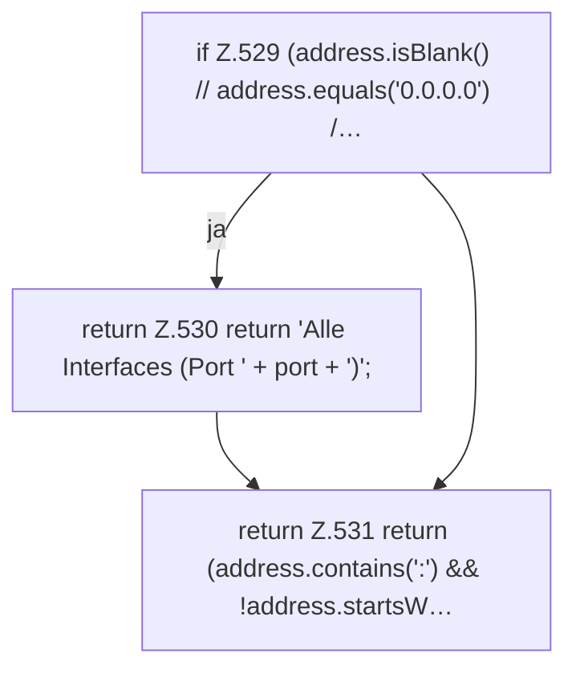

[[00 Start]] › [[Dashboard-HTTP]] › [[API-Status]] › [[Dashboard.formatBindAddress]]

# Dashboard.formatBindAddress

`Dashboard.formatBindAddress(String address, int port)` [src/main/java/de/aichele/childlauncher/Dashboard.java:528–532](https://github.com/Sciddie/minecraft-serverhoster-plugin/blob/95b02b953b0b4c23673e900e021a7c3c844aa37d/src/main/java/de/aichele/childlauncher/Dashboard.java#L528-L532)



```knoten
if Z.529 (address.isBlank() // address.equals('0.0.0.0') /…
  Hier fällt eine Entscheidung. Nur wenn sie zutrifft, geht es den Ja-Weg weiter. Das steht in [[Glossar#Zeile|Zeile]] 529.
return Z.530 return 'Alle Interfaces (Port ' + port + ')';
  Hier endet die [[Glossar#Funktion|Funktion]] und liefert ein Ergebnis zurück. Das steht in [[Glossar#Zeile|Zeile]] 530.
return Z.531 return (address.contains(':') && !address.startsW…
  Hier endet die [[Glossar#Funktion|Funktion]] und liefert ein Ergebnis zurück. Das steht in [[Glossar#Zeile|Zeile]] 531.
```

> [!knoten]- Was die Blöcke tun
> - **if Z.529 (address.isBlank() // address.equals('0.0.0.0') /…**: Hier fällt eine Entscheidung. Nur wenn sie zutrifft, geht es den Ja-Weg weiter. Das steht in [[Glossar#Zeile|Zeile]] 529.
> - **return Z.530 return 'Alle Interfaces (Port ' + port + ')';**: Hier endet die [[Glossar#Funktion|Funktion]] und liefert ein Ergebnis zurück. Das steht in [[Glossar#Zeile|Zeile]] 530.
> - **return Z.531 return (address.contains(':') && !address.startsW…**: Hier endet die [[Glossar#Funktion|Funktion]] und liefert ein Ergebnis zurück. Das steht in [[Glossar#Zeile|Zeile]] 531.

- Die [[Glossar#Web-Schnittstelle|Web-Schnittstelle]] macht lesbar die Bindung die Adresse.
