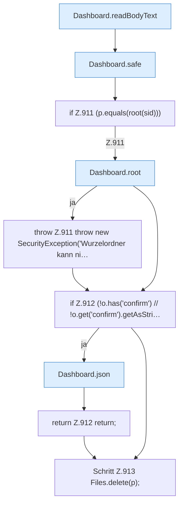

[[00 Start]] › [[Dashboard-HTTP]] › [[API-Dateien]] › [[Dashboard.fsDelete]] › [[Dashboard.fsDelete.Teil1]]

# Dashboard.fsDelete.Teil1



```knoten
Dashboard.readBodyText
  Die [[Glossar#Web-Schnittstelle|Web-Schnittstelle]] liest den Text den Text. Liest `readBodyText`.
Dashboard.safe
  Die [[Glossar#Web-Schnittstelle|Web-Schnittstelle]] macht hier einen einzelnen Schritt. Eine Ebene tiefer steht er genauer. Prüft die Pfadgrenze `safe`. Ruft `guard`, `resolve`.
if Z.911 (p.equals(root(sid)))
  Zeile 911: prüft `(p.equals(root(sid)))`.
Dashboard.root
  Die [[Glossar#Web-Schnittstelle|Web-Schnittstelle]] macht hier einen einzelnen Schritt. Eine Ebene tiefer steht er genauer. Liefert die Wurzel `root`. Ruft `guard`, `root`.
throw Z.911 throw new SecurityException('Wurzelordner kann ni…
  Zeile 911: Abbruch `throw new SecurityException('Wurzelordner kann ni…`.
if Z.912 (!o.has('confirm') // !o.get('confirm').getAsStri…
  Zeile 912: prüft `(!o.has('confirm') // !o.get('confirm').getAsStri…`.
Dashboard.json
  Die [[Glossar#Web-Schnittstelle|Web-Schnittstelle]] macht hier einen einzelnen Schritt. Eine Ebene tiefer steht er genauer. Antwortet mit JSON `json`. Ruft `sendBytes`.
return Z.912 return;
  Zeile 912: Rückgabe `return;`.
Schritt Z.913 Files.delete(p);
  Zeile 913: Dateioperation. `Files.delete(p);`
```

> [!knoten]- Was die Blöcke tun
> - **Dashboard.readBodyText**: Die [[Glossar#Web-Schnittstelle|Web-Schnittstelle]] liest den Text den Text. Liest `readBodyText`.
> - **Dashboard.safe**: Die [[Glossar#Web-Schnittstelle|Web-Schnittstelle]] macht hier einen einzelnen Schritt. Eine Ebene tiefer steht er genauer. Prüft die Pfadgrenze `safe`. Ruft `guard`, `resolve`.
> - **if Z.911 (p.equals(root(sid)))**: Zeile 911: prüft `(p.equals(root(sid)))`.
> - **Dashboard.root**: Die [[Glossar#Web-Schnittstelle|Web-Schnittstelle]] macht hier einen einzelnen Schritt. Eine Ebene tiefer steht er genauer. Liefert die Wurzel `root`. Ruft `guard`, `root`.
> - **throw Z.911 throw new SecurityException('Wurzelordner kann ni…**: Zeile 911: Abbruch `throw new SecurityException('Wurzelordner kann ni…`.
> - **if Z.912 (!o.has('confirm') // !o.get('confirm').getAsStri…**: Zeile 912: prüft `(!o.has('confirm') // !o.get('confirm').getAsStri…`.
> - **Dashboard.json**: Die [[Glossar#Web-Schnittstelle|Web-Schnittstelle]] macht hier einen einzelnen Schritt. Eine Ebene tiefer steht er genauer. Antwortet mit JSON `json`. Ruft `sendBytes`.
> - **return Z.912 return;**: Zeile 912: Rückgabe `return;`.
> - **Schritt Z.913 Files.delete(p);**: Zeile 913: Dateioperation. `Files.delete(p);`

- Ein weiterer Abschnitt derselben Übersicht.
- Fortsetzung von `Dashboard.fsDelete`.
