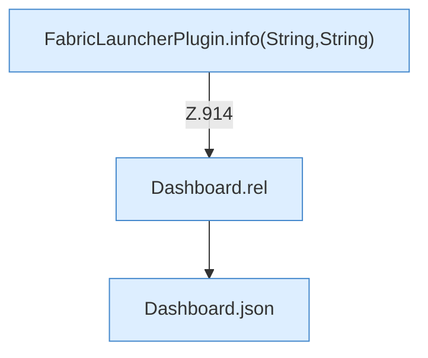

[[00 Start]] › [[Dashboard-HTTP]] › [[API-Dateien]] › [[Dashboard.fsDelete]] › [[Dashboard.fsDelete.Teil2]]

# Dashboard.fsDelete.Teil2



```knoten
FabricLauncherPlugin.info(String,String)
  Schreibt eine Hinweiszeile in die [[Glossar#Konsole|Konsole]] des [[Glossar#Spielserver|Spielservers]]. Schreibt eine Infozeile `info`. Ruft `slot`.
Dashboard.rel
  Die [[Glossar#Web-Schnittstelle|Web-Schnittstelle]] macht hier einen einzelnen Schritt. Eine Ebene tiefer steht er genauer. Rechnet den relativen Pfad `rel`. Ruft `guard`, `relativize`.
Dashboard.json
  Die [[Glossar#Web-Schnittstelle|Web-Schnittstelle]] macht hier einen einzelnen Schritt. Eine Ebene tiefer steht er genauer. Antwortet mit JSON `json`. Ruft `sendBytes`.
```

> [!knoten]- Was die Blöcke tun
> - **FabricLauncherPlugin.info(String,String)**: Schreibt eine Hinweiszeile in die [[Glossar#Konsole|Konsole]] des [[Glossar#Spielserver|Spielservers]]. Schreibt eine Infozeile `info`. Ruft `slot`.
> - **Dashboard.rel**: Die [[Glossar#Web-Schnittstelle|Web-Schnittstelle]] macht hier einen einzelnen Schritt. Eine Ebene tiefer steht er genauer. Rechnet den relativen Pfad `rel`. Ruft `guard`, `relativize`.
> - **Dashboard.json**: Die [[Glossar#Web-Schnittstelle|Web-Schnittstelle]] macht hier einen einzelnen Schritt. Eine Ebene tiefer steht er genauer. Antwortet mit JSON `json`. Ruft `sendBytes`.

- Ein weiterer Abschnitt derselben Übersicht.
- Fortsetzung von `Dashboard.fsDelete`.
