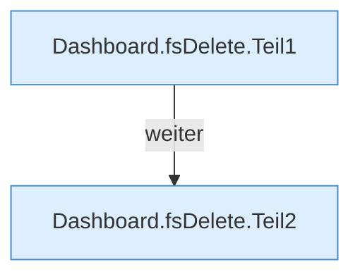

[[00 Start]] › [[Dashboard-HTTP]] › [[API-Dateien]] › [[Dashboard.fsDelete]]

# Dashboard.fsDelete

`Dashboard.fsDelete(HttpExchange ex, String sid)` [src/main/java/de/aichele/childlauncher/Dashboard.java:908–916](https://github.com/Sciddie/minecraft-serverhoster-plugin/blob/95b02b953b0b4c23673e900e021a7c3c844aa37d/src/main/java/de/aichele/childlauncher/Dashboard.java#L908-L916)



```knoten
Dashboard.fsDelete.Teil1
  Ein weiterer Abschnitt derselben Übersicht. Im [[Glossar#Quelltext|Quelltext]] heißt das `Teil1`.
Dashboard.fsDelete.Teil2
  Ein weiterer Abschnitt derselben Übersicht. Im [[Glossar#Quelltext|Quelltext]] heißt das `Teil2`.
```

> [!knoten]- Was die Blöcke tun
> - **Dashboard.fsDelete.Teil1**: Ein weiterer Abschnitt derselben Übersicht. Im [[Glossar#Quelltext|Quelltext]] heißt das `Teil1`.
> - **Dashboard.fsDelete.Teil2**: Ein weiterer Abschnitt derselben Übersicht. Im [[Glossar#Quelltext|Quelltext]] heißt das `Teil2`.

- Die [[Glossar#Web-Schnittstelle|Web-Schnittstelle]] löscht eine Datei.
