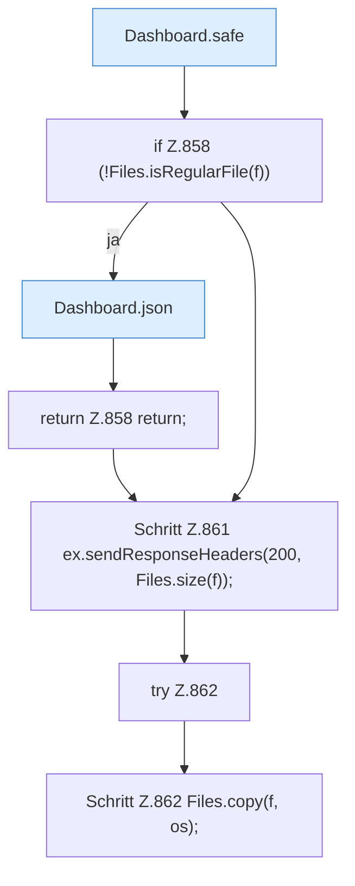

[[00 Start]] › [[Dashboard-HTTP]] › [[API-Dateien]] › [[Dashboard.fsDownload]]

# Dashboard.fsDownload

`Dashboard.fsDownload(HttpExchange ex, Map<String, String> q, String sid)` [src/main/java/de/aichele/childlauncher/Dashboard.java:856–863](https://github.com/Sciddie/minecraft-serverhoster-plugin/blob/95b02b953b0b4c23673e900e021a7c3c844aa37d/src/main/java/de/aichele/childlauncher/Dashboard.java#L856-L863)



```knoten
Dashboard.safe
  Prüft die Pfadgrenze `safe`. Ruft `guard`, `resolve`.
if Z.858 (!Files.isRegularFile(f))
  Zeile 858: prüft `(!Files.isRegularFile(f))`.
Dashboard.json
  Antwortet mit JSON `json`. Ruft `sendBytes`.
return Z.858 return;
  Zeile 858: Rückgabe `return;`.
Schritt Z.861 ex.sendResponseHeaders(200, Files.size(f));
  Zeile 861: Dateioperation. `ex.sendResponseHeaders(200, Files.size(f));`
try Z.862
  Zeile 862: Versuch. Der Fehlerpfad geht in catch.
Schritt Z.862 Files.copy(f, os);
  Zeile 862: Dateioperation. `Files.copy(f, os);`
```

- `fsDownload` in `src/main/java/de/aichele/childlauncher/Dashboard.java`
