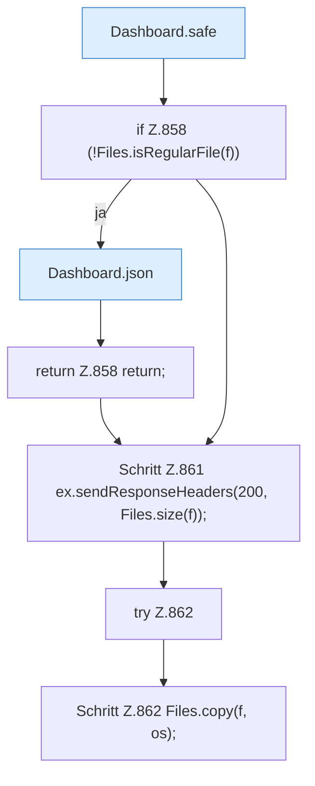

[[00 Start]] › [[Dashboard-HTTP]] › [[API-Dateien]] › [[Dashboard.fsDownload]]

# Dashboard.fsDownload

`Dashboard.fsDownload(HttpExchange ex, Map<String, String> q, String sid)` [src/main/java/de/aichele/childlauncher/Dashboard.java:856–863](https://github.com/Sciddie/minecraft-serverhoster-plugin/blob/95b02b953b0b4c23673e900e021a7c3c844aa37d/src/main/java/de/aichele/childlauncher/Dashboard.java#L856-L863)



```knoten
Dashboard.safe
  Die [[Glossar#Web-Schnittstelle|Web-Schnittstelle]] macht hier einen einzelnen Schritt. Eine Ebene tiefer steht er genauer. Im [[Glossar#Quelltext|Quelltext]] heißt das `safe`.
if Z.858 (!Files.isRegularFile(f))
  Hier fällt eine Entscheidung. Nur wenn sie zutrifft, geht es den Ja-Weg weiter. Das steht in [[Glossar#Zeile|Zeile]] 858.
Dashboard.json
  Die [[Glossar#Web-Schnittstelle|Web-Schnittstelle]] macht hier einen einzelnen Schritt. Eine Ebene tiefer steht er genauer. Im [[Glossar#Quelltext|Quelltext]] heißt das `json`.
return Z.858 return;
  Hier endet die [[Glossar#Funktion|Funktion]] und liefert ein Ergebnis zurück. Das steht in [[Glossar#Zeile|Zeile]] 858.
Schritt Z.861 ex.sendResponseHeaders(200, Files.size(f));
  Ein einzelner Arbeitsschritt, ohne eine weitere eigene [[Glossar#Funktion|Funktion]] aufzurufen. Das steht in [[Glossar#Zeile|Zeile]] 861.
try Z.862
  Das Programm versucht diesen Schritt. Geht er schief, führt der andere Weg weiter. Das steht in [[Glossar#Zeile|Zeile]] 862.
Schritt Z.862 Files.copy(f, os);
  Ein einzelner Arbeitsschritt, ohne eine weitere eigene [[Glossar#Funktion|Funktion]] aufzurufen. Das steht in [[Glossar#Zeile|Zeile]] 862.
```

> [!knoten]- Was die Blöcke tun
> - **Dashboard.safe**: Die [[Glossar#Web-Schnittstelle|Web-Schnittstelle]] macht hier einen einzelnen Schritt. Eine Ebene tiefer steht er genauer. Im [[Glossar#Quelltext|Quelltext]] heißt das `safe`.
> - **if Z.858 (!Files.isRegularFile(f))**: Hier fällt eine Entscheidung. Nur wenn sie zutrifft, geht es den Ja-Weg weiter. Das steht in [[Glossar#Zeile|Zeile]] 858.
> - **Dashboard.json**: Die [[Glossar#Web-Schnittstelle|Web-Schnittstelle]] macht hier einen einzelnen Schritt. Eine Ebene tiefer steht er genauer. Im [[Glossar#Quelltext|Quelltext]] heißt das `json`.
> - **return Z.858 return;**: Hier endet die [[Glossar#Funktion|Funktion]] und liefert ein Ergebnis zurück. Das steht in [[Glossar#Zeile|Zeile]] 858.
> - **Schritt Z.861 ex.sendResponseHeaders(200, Files.size(f));**: Ein einzelner Arbeitsschritt, ohne eine weitere eigene [[Glossar#Funktion|Funktion]] aufzurufen. Das steht in [[Glossar#Zeile|Zeile]] 861.
> - **try Z.862**: Das Programm versucht diesen Schritt. Geht er schief, führt der andere Weg weiter. Das steht in [[Glossar#Zeile|Zeile]] 862.
> - **Schritt Z.862 Files.copy(f, os);**: Ein einzelner Arbeitsschritt, ohne eine weitere eigene [[Glossar#Funktion|Funktion]] aufzurufen. Das steht in [[Glossar#Zeile|Zeile]] 862.

- Die [[Glossar#Web-Schnittstelle|Web-Schnittstelle]] holt eine Datei.
