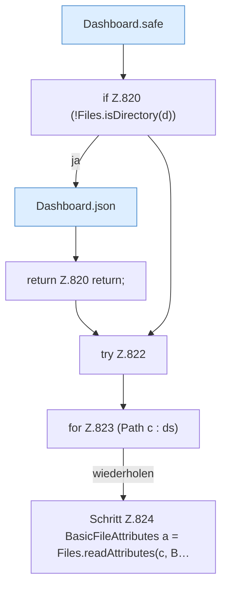

[[00 Start]] › [[Dashboard-HTTP]] › [[API-Dateien]] › [[Dashboard.fsList]] › [[Dashboard.fsList.Teil1]]

# Dashboard.fsList.Teil1



```knoten
Dashboard.safe
  Prüft die Pfadgrenze `safe`. Ruft `guard`, `resolve`.
if Z.820 (!Files.isDirectory(d))
  Zeile 820: prüft `(!Files.isDirectory(d))`.
Dashboard.json
  Antwortet mit JSON `json`. Ruft `sendBytes`.
return Z.820 return;
  Zeile 820: Rückgabe `return;`.
try Z.822
  Zeile 822: Versuch. Der Fehlerpfad geht in catch.
for Z.823 (Path c : ds)
  Zeile 823: Schleife `(Path c : ds)`.
Schritt Z.824 BasicFileAttributes a = Files.readAttributes(c, B…
  Zeile 824: Dateioperation. `BasicFileAttributes a = Files.readAttributes(c, B…`
```

- Fortsetzung von `Dashboard.fsList`, Quellreihenfolge.
