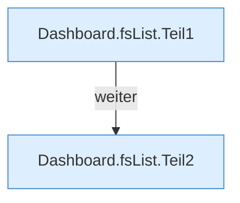

[[00 Start]] › [[Dashboard-HTTP]] › [[API-Dateien]] › [[Dashboard.fsList]]

# Dashboard.fsList

`Dashboard.fsList(HttpExchange ex, Map<String, String> q, String sid)` [src/main/java/de/aichele/childlauncher/Dashboard.java:818–830](https://github.com/Sciddie/minecraft-serverhoster-plugin/blob/95b02b953b0b4c23673e900e021a7c3c844aa37d/src/main/java/de/aichele/childlauncher/Dashboard.java#L818-L830)



```knoten
Dashboard.fsList.Teil1
  Ein weiterer Abschnitt derselben Übersicht. Im [[Glossar#Quelltext|Quelltext]] heißt das `Teil1`.
Dashboard.fsList.Teil2
  Ein weiterer Abschnitt derselben Übersicht. Im [[Glossar#Quelltext|Quelltext]] heißt das `Teil2`.
```

> [!knoten]- Was die Blöcke tun
> - **Dashboard.fsList.Teil1**: Ein weiterer Abschnitt derselben Übersicht. Im [[Glossar#Quelltext|Quelltext]] heißt das `Teil1`.
> - **Dashboard.fsList.Teil2**: Ein weiterer Abschnitt derselben Übersicht. Im [[Glossar#Quelltext|Quelltext]] heißt das `Teil2`.

- Die [[Glossar#Web-Schnittstelle|Web-Schnittstelle]] zeigt eine Datei.
