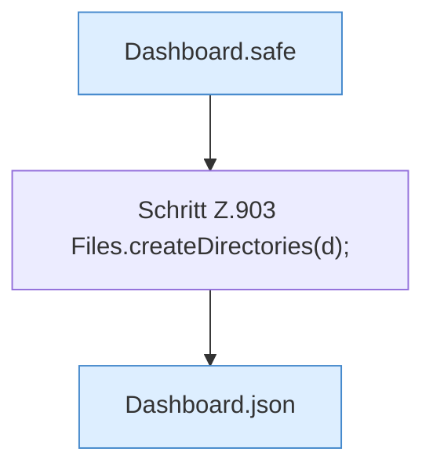

[[00 Start]] › [[Dashboard-HTTP]] › [[API-Dateien]] › [[Dashboard.fsMkdir]]

# Dashboard.fsMkdir

`Dashboard.fsMkdir(HttpExchange ex, Map<String, String> q, String sid)` [src/main/java/de/aichele/childlauncher/Dashboard.java:901–905](https://github.com/Sciddie/minecraft-serverhoster-plugin/blob/95b02b953b0b4c23673e900e021a7c3c844aa37d/src/main/java/de/aichele/childlauncher/Dashboard.java#L901-L905)



```knoten
Dashboard.safe
  Die [[Glossar#Web-Schnittstelle|Web-Schnittstelle]] macht hier einen einzelnen Schritt. Eine Ebene tiefer steht er genauer. Im [[Glossar#Quelltext|Quelltext]] heißt das `safe`.
Schritt Z.903 Files.createDirectories(d);
  Ein einzelner Arbeitsschritt, ohne eine weitere eigene [[Glossar#Funktion|Funktion]] aufzurufen. Das steht in [[Glossar#Zeile|Zeile]] 903.
Dashboard.json
  Die [[Glossar#Web-Schnittstelle|Web-Schnittstelle]] macht hier einen einzelnen Schritt. Eine Ebene tiefer steht er genauer. Im [[Glossar#Quelltext|Quelltext]] heißt das `json`.
```

> [!knoten]- Was die Blöcke tun
> - **Dashboard.safe**: Die [[Glossar#Web-Schnittstelle|Web-Schnittstelle]] macht hier einen einzelnen Schritt. Eine Ebene tiefer steht er genauer. Im [[Glossar#Quelltext|Quelltext]] heißt das `safe`.
> - **Schritt Z.903 Files.createDirectories(d);**: Ein einzelner Arbeitsschritt, ohne eine weitere eigene [[Glossar#Funktion|Funktion]] aufzurufen. Das steht in [[Glossar#Zeile|Zeile]] 903.
> - **Dashboard.json**: Die [[Glossar#Web-Schnittstelle|Web-Schnittstelle]] macht hier einen einzelnen Schritt. Eine Ebene tiefer steht er genauer. Im [[Glossar#Quelltext|Quelltext]] heißt das `json`.

- Die [[Glossar#Web-Schnittstelle|Web-Schnittstelle]] legt einen Ordner an für eine Datei.
