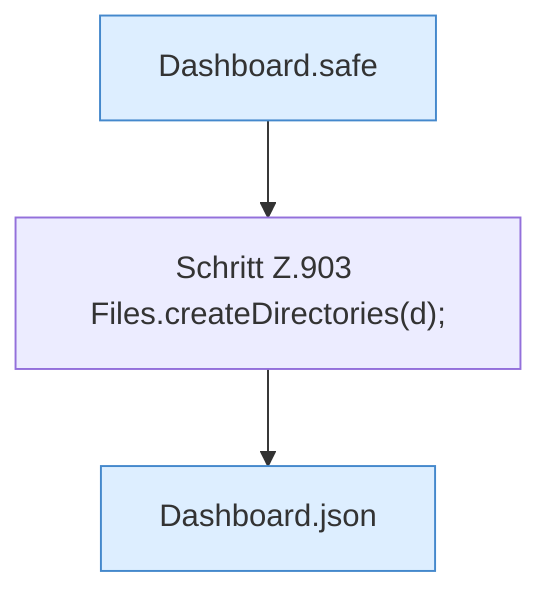

[[00 Start]] › [[Dashboard-HTTP]] › [[API-Dateien]] › [[Dashboard.fsMkdir]]

# Dashboard.fsMkdir

`Dashboard.fsMkdir(HttpExchange ex, Map<String, String> q, String sid)` [src/main/java/de/aichele/childlauncher/Dashboard.java:901–905](https://github.com/Sciddie/minecraft-serverhoster-plugin/blob/95b02b953b0b4c23673e900e021a7c3c844aa37d/src/main/java/de/aichele/childlauncher/Dashboard.java#L901-L905)

- `fsMkdir` in `src/main/java/de/aichele/childlauncher/Dashboard.java`
