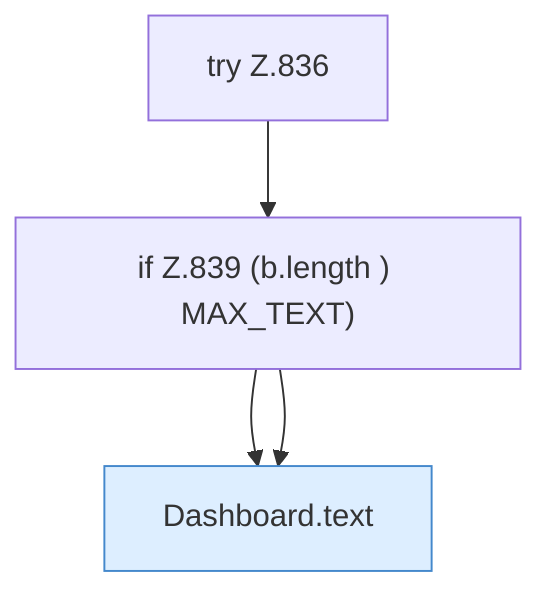

[[00 Start]] › [[Dashboard-HTTP]] › [[API-Dateien]] › [[Dashboard.fsRead]] › [[Dashboard.fsRead.Z835.Z836]]

# Dashboard.fsRead.Z835.Z836



```knoten
try Z.836
  Zeile 836: Versuch. Der Fehlerpfad geht in catch.
if Z.839 (b.length ) MAX_TEXT)
  Zeile 839: prüft `(b.length ) MAX_TEXT)`.
Dashboard.text
  Antwortet mit Text `text`. Ruft `sendBytes`.
```

- Fortsetzung von `Dashboard.fsRead.Z835`, Quellreihenfolge.
