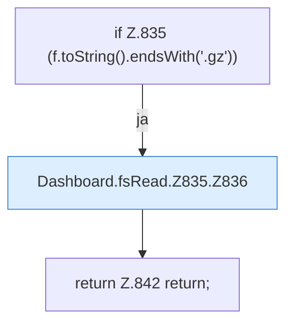

[[00 Start]] › [[Dashboard-HTTP]] › [[API-Dateien]] › [[Dashboard.fsRead]] › [[Dashboard.fsRead.Z835]]

# Dashboard.fsRead.Z835



```knoten
if Z.835 (f.toString().endsWith('.gz'))
  Zeile 835: prüft `(f.toString().endsWith('.gz'))`.
Dashboard.fsRead.Z835.Z836
  Fortsetzung des Ablaufs ab Zeile 836.
return Z.842 return;
  Zeile 842: Rückgabe `return;`.
```

- Fortsetzung von `Dashboard.fsRead`, Quellreihenfolge.
