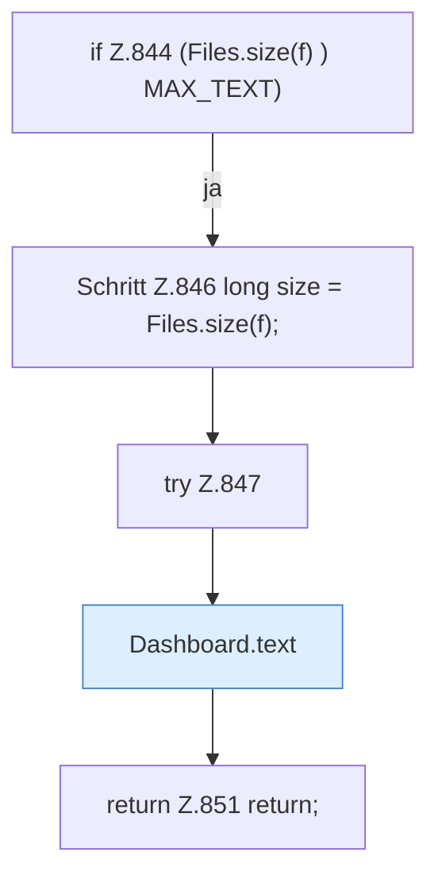

[[00 Start]] › [[Dashboard-HTTP]] › [[API-Dateien]] › [[Dashboard.fsRead]] › [[Dashboard.fsRead.Z844]]

# Dashboard.fsRead.Z844



```knoten
if Z.844 (Files.size(f) ) MAX_TEXT)
  Zeile 844: prüft `(Files.size(f) ) MAX_TEXT)`.
Schritt Z.846 long size = Files.size(f);
  Zeile 846: Dateioperation. `long size = Files.size(f);`
try Z.847
  Zeile 847: Versuch. Der Fehlerpfad geht in catch.
Dashboard.text
  Die [[Glossar#Web-Schnittstelle|Web-Schnittstelle]] macht hier einen einzelnen Schritt. Eine Ebene tiefer steht er genauer. Antwortet mit Text `text`. Ruft `sendBytes`.
return Z.851 return;
  Zeile 851: Rückgabe `return;`.
```

> [!knoten]- Was die Blöcke tun
> - **if Z.844 (Files.size(f) ) MAX_TEXT)**: Zeile 844: prüft `(Files.size(f) ) MAX_TEXT)`.
> - **Schritt Z.846 long size = Files.size(f);**: Zeile 846: Dateioperation. `long size = Files.size(f);`
> - **try Z.847**: Zeile 847: Versuch. Der Fehlerpfad geht in catch.
> - **Dashboard.text**: Die [[Glossar#Web-Schnittstelle|Web-Schnittstelle]] macht hier einen einzelnen Schritt. Eine Ebene tiefer steht er genauer. Antwortet mit Text `text`. Ruft `sendBytes`.
> - **return Z.851 return;**: Zeile 851: Rückgabe `return;`.

- Der Ablauf geht in [[Glossar#Zeile|Zeile]] 844 weiter. Eine Ebene tiefer steht er genauer.
- Fortsetzung von `Dashboard.fsRead`.
