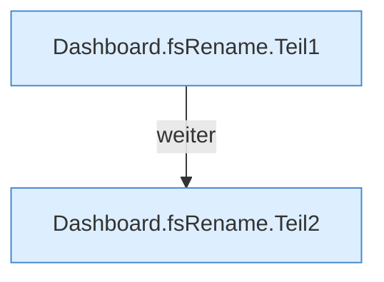

[[00 Start]] › [[Dashboard-HTTP]] › [[API-Dateien]] › [[Dashboard.fsRename]]

# Dashboard.fsRename

`Dashboard.fsRename(HttpExchange ex, String sid)` [src/main/java/de/aichele/childlauncher/Dashboard.java:891–899](https://github.com/Sciddie/minecraft-serverhoster-plugin/blob/95b02b953b0b4c23673e900e021a7c3c844aa37d/src/main/java/de/aichele/childlauncher/Dashboard.java#L891-L899)



```knoten
Dashboard.fsRename.Teil1
  Abschnitt 1 dieses Ablaufs, in Quellreihenfolge.
Dashboard.fsRename.Teil2
  Abschnitt 2 dieses Ablaufs, in Quellreihenfolge.
```

- `fsRename` in `src/main/java/de/aichele/childlauncher/Dashboard.java`
