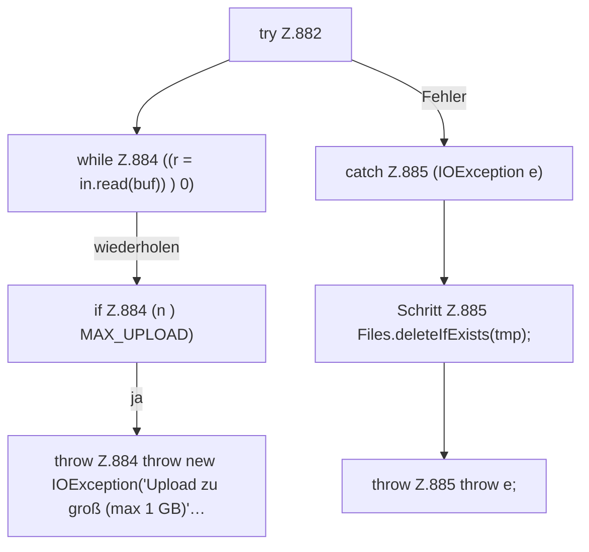

[[00 Start]] › [[Dashboard-HTTP]] › [[API-Dateien]] › [[Dashboard.fsUpload]] › [[Dashboard.fsUpload.Teil2.Z882]]

# Dashboard.fsUpload.Teil2.Z882

- Fortsetzung von `Dashboard.fsUpload.Teil2`, Quellreihenfolge.
