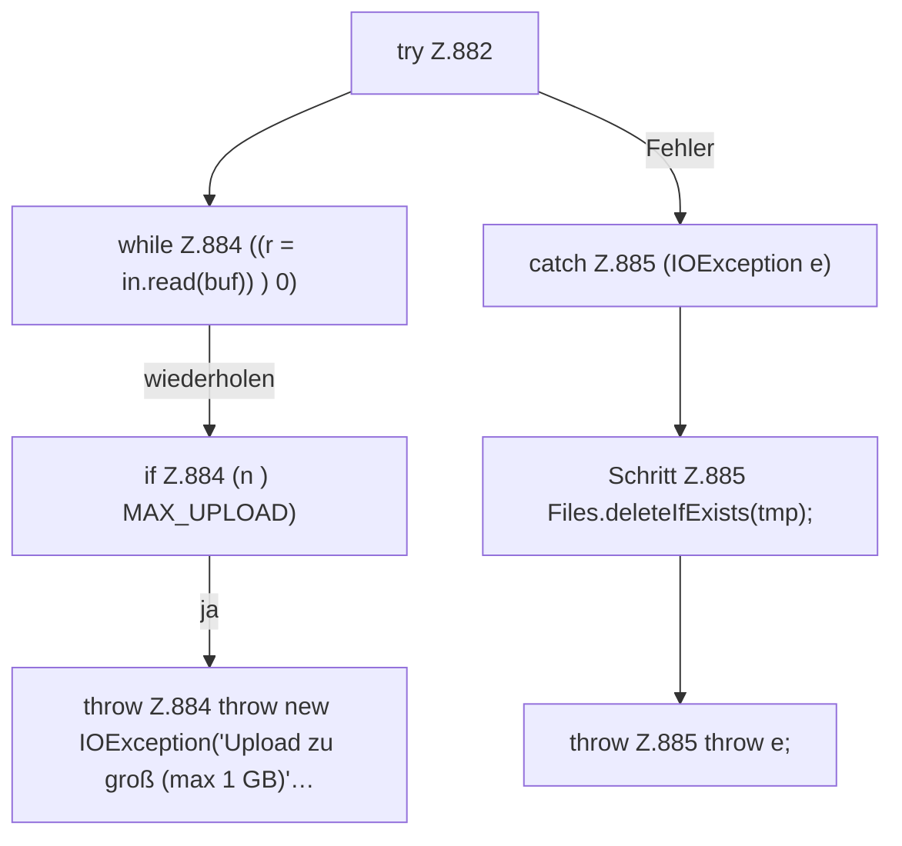

[[00 Start]] › [[Dashboard-HTTP]] › [[API-Dateien]] › [[Dashboard.fsUpload]] › [[Dashboard.fsUpload.Teil2.Z882]]

# Dashboard.fsUpload.Teil2.Z882



```knoten
try Z.882
  Zeile 882: Versuch. Der Fehlerpfad geht in catch.
while Z.884 ((r = in.read(buf)) ) 0)
  Zeile 884: Schleife `((r = in.read(buf)) ) 0)`.
if Z.884 (n ) MAX_UPLOAD)
  Zeile 884: prüft `(n ) MAX_UPLOAD)`.
throw Z.884 throw new IOException('Upload zu groß (max 1 GB)'…
  Zeile 884: Abbruch `throw new IOException('Upload zu groß (max 1 GB)'…`.
catch Z.885 (IOException e)
  Zeile 885: fängt (IOException e).
Schritt Z.885 Files.deleteIfExists(tmp);
  Zeile 885: Dateioperation. `Files.deleteIfExists(tmp);`
throw Z.885 throw e;
  Zeile 885: Abbruch `throw e;`.
```

- Fortsetzung von `Dashboard.fsUpload.Teil2`, Quellreihenfolge.
