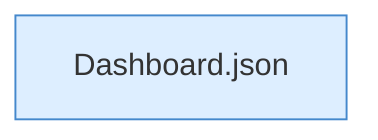

[[00 Start]] › [[Dashboard-HTTP]] › [[API-Dateien]] › [[Dashboard.fsUpload]] › [[Dashboard.fsUpload.Teil3]]

# Dashboard.fsUpload.Teil3



```knoten
Dashboard.json
  Antwortet mit JSON `json`. Ruft `sendBytes`.
```

- Fortsetzung von `Dashboard.fsUpload`, Quellreihenfolge.
