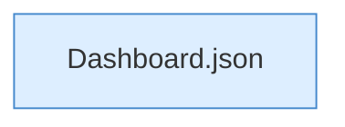

[[00 Start]] › [[Dashboard-HTTP]] › [[API-Dateien]] › [[Dashboard.fsWrite]] › [[Dashboard.fsWrite.Teil2]]

# Dashboard.fsWrite.Teil2



```knoten
Dashboard.json
  Antwortet mit JSON `json`. Ruft `sendBytes`.
```

- Fortsetzung von `Dashboard.fsWrite`, Quellreihenfolge.
