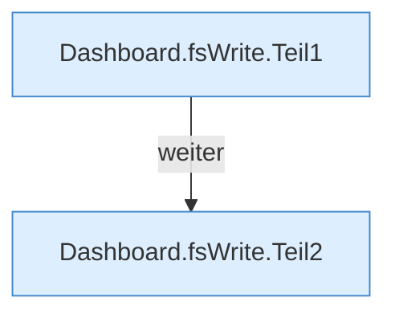

[[00 Start]] › [[Dashboard-HTTP]] › [[API-Dateien]] › [[Dashboard.fsWrite]]

# Dashboard.fsWrite

`Dashboard.fsWrite(HttpExchange ex, Map<String, String> q, String sid)` [src/main/java/de/aichele/childlauncher/Dashboard.java:865–872](https://github.com/Sciddie/minecraft-serverhoster-plugin/blob/95b02b953b0b4c23673e900e021a7c3c844aa37d/src/main/java/de/aichele/childlauncher/Dashboard.java#L865-L872)



```knoten
Dashboard.fsWrite.Teil1
  Abschnitt 1 dieses Ablaufs, in Quellreihenfolge.
Dashboard.fsWrite.Teil2
  Abschnitt 2 dieses Ablaufs, in Quellreihenfolge.
```

- `fsWrite` in `src/main/java/de/aichele/childlauncher/Dashboard.java`
