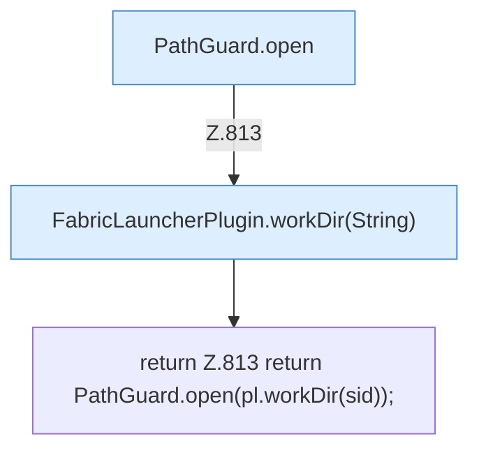

[[00 Start]] › [[Dashboard-HTTP]] › [[API-Setup]] › [[Dashboard.guard]]

# Dashboard.guard

`Dashboard.guard(String sid)` [src/main/java/de/aichele/childlauncher/Dashboard.java:813–813](https://github.com/Sciddie/minecraft-serverhoster-plugin/blob/95b02b953b0b4c23673e900e021a7c3c844aa37d/src/main/java/de/aichele/childlauncher/Dashboard.java#L813-L813)



```knoten
PathGuard.open
  Dieser Teil öffnet das. Im [[Glossar#Quelltext|Quelltext]] heißt das `open`.
FabricLauncherPlugin.workDir(String)
  Liefert den Ordner, in dem der [[Glossar#Spielserver|Spielserver]] arbeitet. Im [[Glossar#Quelltext|Quelltext]] heißt das `workDir(String)`.
return Z.813 return PathGuard.open(pl.workDir(sid));
  Hier endet die [[Glossar#Funktion|Funktion]] und liefert ein Ergebnis zurück. Das steht in [[Glossar#Zeile|Zeile]] 813.
```

> [!knoten]- Was die Blöcke tun
> - **PathGuard.open**: Dieser Teil öffnet das. Im [[Glossar#Quelltext|Quelltext]] heißt das `open`.
> - **FabricLauncherPlugin.workDir(String)**: Liefert den Ordner, in dem der [[Glossar#Spielserver|Spielserver]] arbeitet. Im [[Glossar#Quelltext|Quelltext]] heißt das `workDir(String)`.
> - **return Z.813 return PathGuard.open(pl.workDir(sid));**: Hier endet die [[Glossar#Funktion|Funktion]] und liefert ein Ergebnis zurück. Das steht in [[Glossar#Zeile|Zeile]] 813.

- Die [[Glossar#Web-Schnittstelle|Web-Schnittstelle]] macht hier einen einzelnen Schritt. Eine Ebene tiefer steht er genauer.
