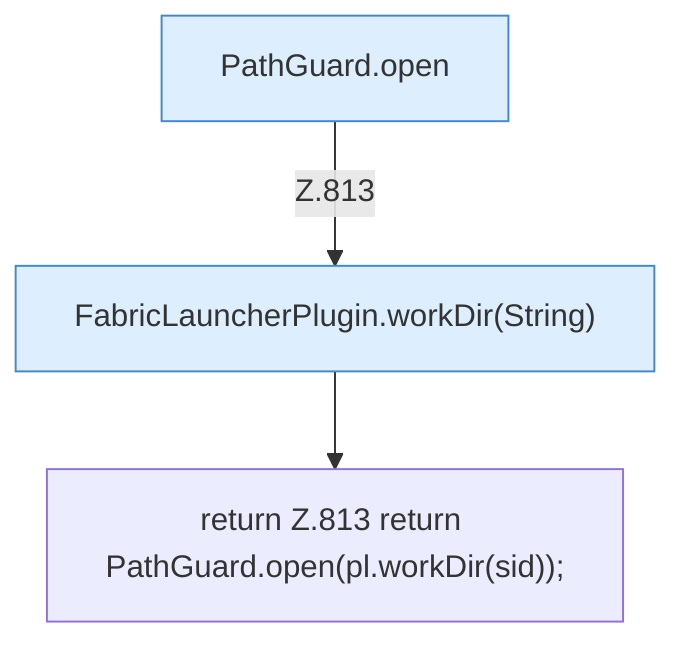

[[00 Start]] › [[Dashboard-HTTP]] › [[API-Setup]] › [[Dashboard.guard]]

# Dashboard.guard

`Dashboard.guard(String sid)` [src/main/java/de/aichele/childlauncher/Dashboard.java:813–813](https://github.com/Sciddie/minecraft-serverhoster-plugin/blob/95b02b953b0b4c23673e900e021a7c3c844aa37d/src/main/java/de/aichele/childlauncher/Dashboard.java#L813-L813)

- `guard` in `src/main/java/de/aichele/childlauncher/Dashboard.java`
