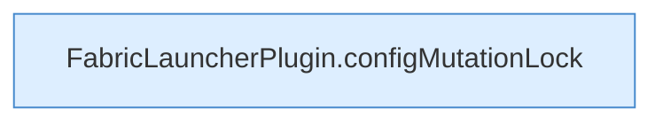

[[00 Start]] › [[Dashboard-HTTP]] › [[HTTP-Routing]] › [[Dashboard.handle]] › [[Dashboard.handle.Aufrufe]]

# Dashboard.handle.Aufrufe



```knoten
FabricLauncherPlugin.configMutationLock
  `configMutationLock` in `FabricLauncherPlugin.java`.
```

- Fortsetzung von `Dashboard.handle`, Quellreihenfolge.
- ungeprüft: Ablaufparser oder nachgetragene Aufrufe, siehe [[bericht]].
