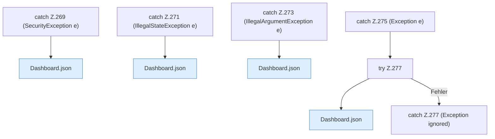

[[00 Start]] › [[Dashboard-HTTP]] › [[HTTP-Routing]] › [[Dashboard.handle]] › [[Dashboard.handle.Z103.Catch103]]

# Dashboard.handle.Z103.Catch103



```knoten
catch Z.269 (SecurityException e)
  Zeile 269: fängt (SecurityException e).
Dashboard.json
  Die [[Glossar#Web-Schnittstelle|Web-Schnittstelle]] macht hier einen einzelnen Schritt. Eine Ebene tiefer steht er genauer. Antwortet mit JSON `json`. Ruft `sendBytes`.
catch Z.271 (IllegalStateException e)
  Zeile 271: fängt (IllegalStateException e).
catch Z.273 (IllegalArgumentException e)
  Zeile 273: fängt (IllegalArgumentException e).
catch Z.275 (Exception e)
  Zeile 275: fängt (Exception e).
try Z.277
  Zeile 277: Versuch. Der Fehlerpfad geht in catch.
catch Z.277 (Exception ignored)
  Zeile 277: fängt (Exception ignored).
```

> [!knoten]- Was die Blöcke tun
> - **catch Z.269 (SecurityException e)**: Zeile 269: fängt (SecurityException e).
> - **Dashboard.json**: Die [[Glossar#Web-Schnittstelle|Web-Schnittstelle]] macht hier einen einzelnen Schritt. Eine Ebene tiefer steht er genauer. Antwortet mit JSON `json`. Ruft `sendBytes`.
> - **catch Z.271 (IllegalStateException e)**: Zeile 271: fängt (IllegalStateException e).
> - **catch Z.273 (IllegalArgumentException e)**: Zeile 273: fängt (IllegalArgumentException e).
> - **catch Z.275 (Exception e)**: Zeile 275: fängt (Exception e).
> - **try Z.277**: Zeile 277: Versuch. Der Fehlerpfad geht in catch.
> - **catch Z.277 (Exception ignored)**: Zeile 277: fängt (Exception ignored).

- Was passiert, wenn der Schritt in [[Glossar#Zeile|Zeile]] 103 schiefgeht.
- Fortsetzung von `Dashboard.handle.Z103`.
