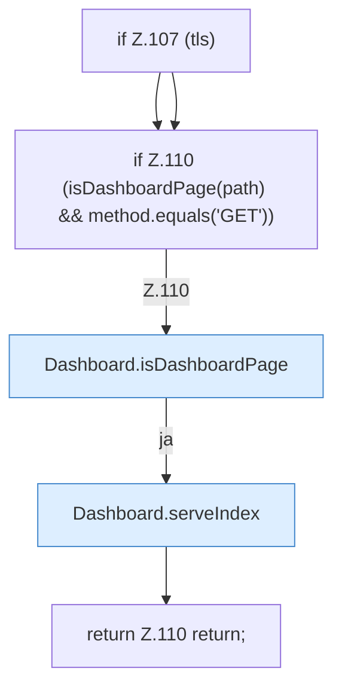

[[00 Start]] › [[Dashboard-HTTP]] › [[HTTP-Routing]] › [[Dashboard.handle]] › [[Dashboard.handle.Z103.Teil1]]

# Dashboard.handle.Z103.Teil1



```knoten
if Z.107 (tls)
  Zeile 107: prüft `(tls)`.
if Z.110 (isDashboardPage(path) && method.equals('GET'))
  Zeile 110: prüft `(isDashboardPage(path) && method.equals('GET'))`.
Dashboard.isDashboardPage
  Prüft `isDashboardPage`.
Dashboard.serveIndex
  Liefert `serveIndex`. Ruft `sendBytes`.
return Z.110 return;
  Zeile 110: Rückgabe `return;`.
```

- Fortsetzung von `Dashboard.handle.Z103`, Quellreihenfolge.
