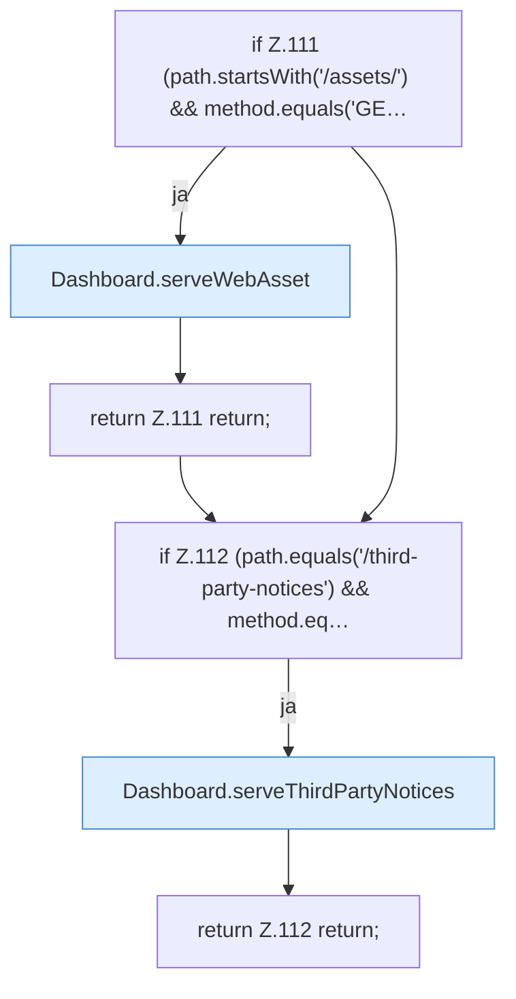

[[00 Start]] › [[Dashboard-HTTP]] › [[HTTP-Routing]] › [[Dashboard.handle]] › [[Dashboard.handle.Z103.Teil2]]

# Dashboard.handle.Z103.Teil2



```knoten
if Z.111 (path.startsWith('/assets/') && method.equals('GE…
  Zeile 111: prüft `(path.startsWith('/assets/') && method.equals('GE…`.
Dashboard.serveWebAsset
  Die [[Glossar#Web-Schnittstelle|Web-Schnittstelle]] liefert die Seite eine Datei der Seite. Liefert `serveWebAsset`. Ruft `send`, `sendBytes`.
return Z.111 return;
  Zeile 111: Rückgabe `return;`.
if Z.112 (path.equals('/third-party-notices') && method.eq…
  Zeile 112: prüft `(path.equals('/third-party-notices') && method.eq…`.
Dashboard.serveThirdPartyNotices
  Die [[Glossar#Web-Schnittstelle|Web-Schnittstelle]] liefert fremde Bausteine die Hinweise. Liefert `serveThirdPartyNotices`. Ruft `send`.
return Z.112 return;
  Zeile 112: Rückgabe `return;`.
```

> [!knoten]- Was die Blöcke tun
> - **if Z.111 (path.startsWith('/assets/') && method.equals('GE…**: Zeile 111: prüft `(path.startsWith('/assets/') && method.equals('GE…`.
> - **Dashboard.serveWebAsset**: Die [[Glossar#Web-Schnittstelle|Web-Schnittstelle]] liefert die Seite eine Datei der Seite. Liefert `serveWebAsset`. Ruft `send`, `sendBytes`.
> - **return Z.111 return;**: Zeile 111: Rückgabe `return;`.
> - **if Z.112 (path.equals('/third-party-notices') && method.eq…**: Zeile 112: prüft `(path.equals('/third-party-notices') && method.eq…`.
> - **Dashboard.serveThirdPartyNotices**: Die [[Glossar#Web-Schnittstelle|Web-Schnittstelle]] liefert fremde Bausteine die Hinweise. Liefert `serveThirdPartyNotices`. Ruft `send`.
> - **return Z.112 return;**: Zeile 112: Rückgabe `return;`.

- Ein weiterer Abschnitt derselben Übersicht.
- Fortsetzung von `Dashboard.handle.Z103`.
