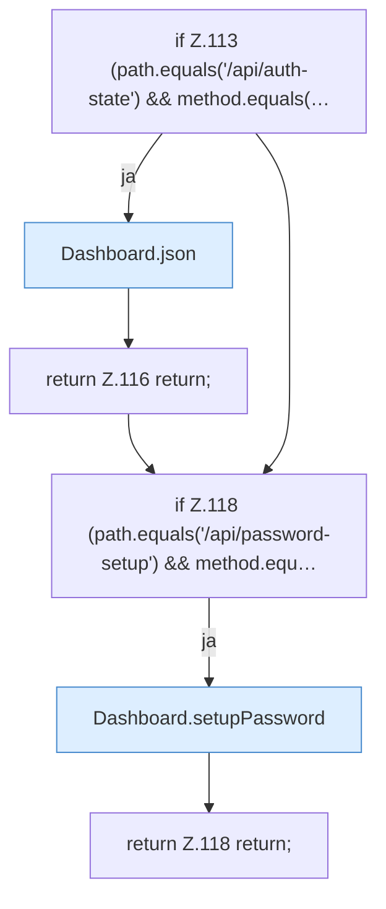

[[00 Start]] › [[Dashboard-HTTP]] › [[HTTP-Routing]] › [[Dashboard.handle]] › [[Dashboard.handle.Z103.Teil3]]

# Dashboard.handle.Z103.Teil3



```knoten
if Z.113 (path.equals('/api/auth-state') && method.equals(…
  Zeile 113: prüft `(path.equals('/api/auth-state') && method.equals(…`.
Dashboard.json
  Die [[Glossar#Web-Schnittstelle|Web-Schnittstelle]] macht hier einen einzelnen Schritt. Eine Ebene tiefer steht er genauer. Antwortet mit JSON `json`. Ruft `sendBytes`.
return Z.116 return;
  Zeile 116: Rückgabe `return;`.
if Z.118 (path.equals('/api/password-setup') && method.equ…
  Zeile 118: prüft `(path.equals('/api/password-setup') && method.equ…`.
Dashboard.setupPassword
  Legt das Passwort der [[Glossar#Bedienseite|Bedienseite]] fest, wenn noch keines da ist. `setupPassword` in `Dashboard.java`. Ruft `csrfRejected`, `json`, `ip`.
return Z.118 return;
  Zeile 118: Rückgabe `return;`.
```

> [!knoten]- Was die Blöcke tun
> - **if Z.113 (path.equals('/api/auth-state') && method.equals(…**: Zeile 113: prüft `(path.equals('/api/auth-state') && method.equals(…`.
> - **Dashboard.json**: Die [[Glossar#Web-Schnittstelle|Web-Schnittstelle]] macht hier einen einzelnen Schritt. Eine Ebene tiefer steht er genauer. Antwortet mit JSON `json`. Ruft `sendBytes`.
> - **return Z.116 return;**: Zeile 116: Rückgabe `return;`.
> - **if Z.118 (path.equals('/api/password-setup') && method.equ…**: Zeile 118: prüft `(path.equals('/api/password-setup') && method.equ…`.
> - **Dashboard.setupPassword**: Legt das Passwort der [[Glossar#Bedienseite|Bedienseite]] fest, wenn noch keines da ist. `setupPassword` in `Dashboard.java`. Ruft `csrfRejected`, `json`, `ip`.
> - **return Z.118 return;**: Zeile 118: Rückgabe `return;`.

- Ein weiterer Abschnitt derselben Übersicht.
- Fortsetzung von `Dashboard.handle.Z103`.
