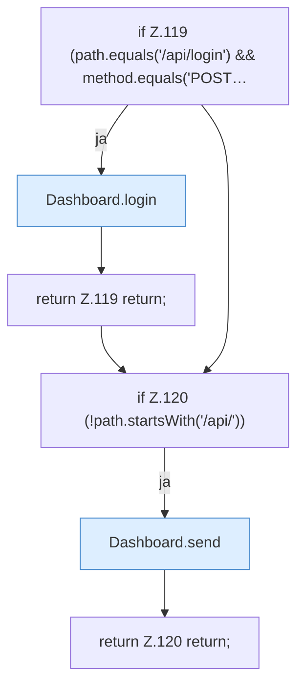

[[00 Start]] › [[Dashboard-HTTP]] › [[HTTP-Routing]] › [[Dashboard.handle]] › [[Dashboard.handle.Z103.Teil4]]

# Dashboard.handle.Z103.Teil4



```knoten
if Z.119 (path.equals('/api/login') && method.equals('POST…
  Zeile 119: prüft `(path.equals('/api/login') && method.equals('POST…`.
Dashboard.login
  Meldet an `login`. Ruft `ip`, `json`, `body`.
return Z.119 return;
  Zeile 119: Rückgabe `return;`.
if Z.120 (!path.startsWith('/api/'))
  Zeile 120: prüft `(!path.startsWith('/api/'))`.
Dashboard.send
  Sendet `send`. Ruft `sendBytes`.
return Z.120 return;
  Zeile 120: Rückgabe `return;`.
```

- Fortsetzung von `Dashboard.handle.Z103`, Quellreihenfolge.
