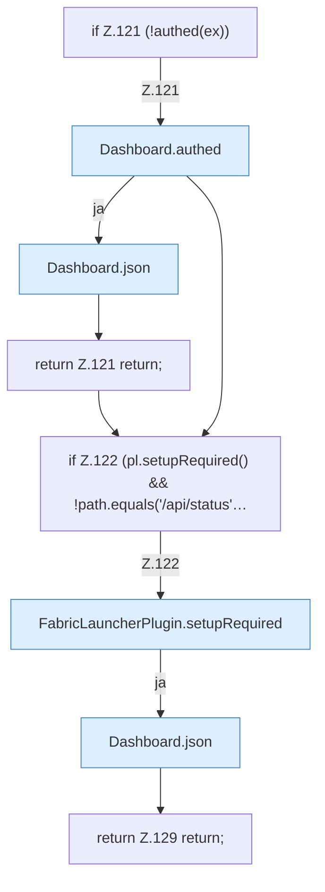

[[00 Start]] › [[Dashboard-HTTP]] › [[HTTP-Routing]] › [[Dashboard.handle]] › [[Dashboard.handle.Z103.Teil5]]

# Dashboard.handle.Z103.Teil5



```knoten
if Z.121 (!authed(ex))
  Zeile 121: prüft `(!authed(ex))`.
Dashboard.authed
  Die [[Glossar#Web-Schnittstelle|Web-Schnittstelle]] macht hier einen einzelnen Schritt. Eine Ebene tiefer steht er genauer. `authed` in `Dashboard.java`. Ruft `token`.
Dashboard.json
  Die [[Glossar#Web-Schnittstelle|Web-Schnittstelle]] macht hier einen einzelnen Schritt. Eine Ebene tiefer steht er genauer. Antwortet mit JSON `json`. Ruft `sendBytes`.
return Z.121 return;
  Zeile 121: Rückgabe `return;`.
if Z.122 (pl.setupRequired() && !path.equals('/api/status'…
  Zeile 122: prüft `(pl.setupRequired() && !path.equals('/api/status'…`.
FabricLauncherPlugin.setupRequired
  Das [[Glossar#Plugin|Plugin]] kümmert sich um einen Pflichtwert. `setupRequired` in `FabricLauncherPlugin.java`.
return Z.129 return;
  Zeile 129: Rückgabe `return;`.
```

> [!knoten]- Was die Blöcke tun
> - **if Z.121 (!authed(ex))**: Zeile 121: prüft `(!authed(ex))`.
> - **Dashboard.authed**: Die [[Glossar#Web-Schnittstelle|Web-Schnittstelle]] macht hier einen einzelnen Schritt. Eine Ebene tiefer steht er genauer. `authed` in `Dashboard.java`. Ruft `token`.
> - **Dashboard.json**: Die [[Glossar#Web-Schnittstelle|Web-Schnittstelle]] macht hier einen einzelnen Schritt. Eine Ebene tiefer steht er genauer. Antwortet mit JSON `json`. Ruft `sendBytes`.
> - **return Z.121 return;**: Zeile 121: Rückgabe `return;`.
> - **if Z.122 (pl.setupRequired() && !path.equals('/api/status'…**: Zeile 122: prüft `(pl.setupRequired() && !path.equals('/api/status'…`.
> - **FabricLauncherPlugin.setupRequired**: Das [[Glossar#Plugin|Plugin]] kümmert sich um einen Pflichtwert. `setupRequired` in `FabricLauncherPlugin.java`.
> - **return Z.129 return;**: Zeile 129: Rückgabe `return;`.

- Ein weiterer Abschnitt derselben Übersicht.
- Fortsetzung von `Dashboard.handle.Z103`.
