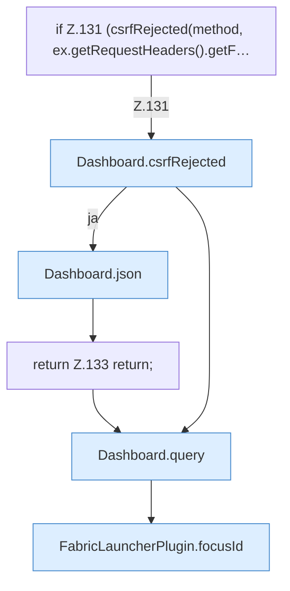

[[00 Start]] › [[Dashboard-HTTP]] › [[HTTP-Routing]] › [[Dashboard.handle]] › [[Dashboard.handle.Z103.Teil6]]

# Dashboard.handle.Z103.Teil6



```knoten
if Z.131 (csrfRejected(method, ex.getRequestHeaders().getF…
  Zeile 131: prüft `(csrfRejected(method, ex.getRequestHeaders().getF…`.
Dashboard.csrfRejected
  `csrfRejected` in `Dashboard.java`.
Dashboard.json
  Antwortet mit JSON `json`. Ruft `sendBytes`.
return Z.133 return;
  Zeile 133: Rückgabe `return;`.
Dashboard.query
  Fragt ab `query`.
FabricLauncherPlugin.focusId
  Liefert oder setzt den Fokus `focusId`.
```

- Fortsetzung von `Dashboard.handle.Z103`, Quellreihenfolge.
