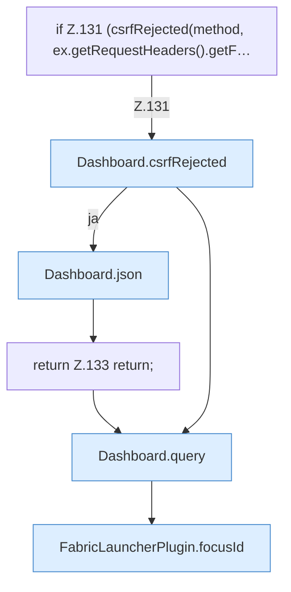

[[00 Start]] › [[Dashboard-HTTP]] › [[HTTP-Routing]] › [[Dashboard.handle]] › [[Dashboard.handle.Z103.Teil6]]

# Dashboard.handle.Z103.Teil6



```knoten
if Z.131 (csrfRejected(method, ex.getRequestHeaders().getF…
  Zeile 131: prüft `(csrfRejected(method, ex.getRequestHeaders().getF…`.
Dashboard.csrfRejected
  Lehnt eine Anfrage ab, die nicht von der eigenen [[Glossar#Bedienseite|Bedienseite]] kommt. `csrfRejected` in `Dashboard.java`.
Dashboard.json
  Die [[Glossar#Web-Schnittstelle|Web-Schnittstelle]] macht hier einen einzelnen Schritt. Eine Ebene tiefer steht er genauer. Antwortet mit JSON `json`. Ruft `sendBytes`.
return Z.133 return;
  Zeile 133: Rückgabe `return;`.
Dashboard.query
  Liest eine Angabe aus der Adresse der Anfrage. Fragt ab `query`.
FabricLauncherPlugin.focusId
  Das [[Glossar#Plugin|Plugin]] liefert die Kennung. Liefert oder setzt den [[Glossar#Fokus|Fokus]] `focusId`.
```

> [!knoten]- Was die Blöcke tun
> - **if Z.131 (csrfRejected(method, ex.getRequestHeaders().getF…**: Zeile 131: prüft `(csrfRejected(method, ex.getRequestHeaders().getF…`.
> - **Dashboard.csrfRejected**: Lehnt eine Anfrage ab, die nicht von der eigenen [[Glossar#Bedienseite|Bedienseite]] kommt. `csrfRejected` in `Dashboard.java`.
> - **Dashboard.json**: Die [[Glossar#Web-Schnittstelle|Web-Schnittstelle]] macht hier einen einzelnen Schritt. Eine Ebene tiefer steht er genauer. Antwortet mit JSON `json`. Ruft `sendBytes`.
> - **return Z.133 return;**: Zeile 133: Rückgabe `return;`.
> - **Dashboard.query**: Liest eine Angabe aus der Adresse der Anfrage. Fragt ab `query`.
> - **FabricLauncherPlugin.focusId**: Das [[Glossar#Plugin|Plugin]] liefert die Kennung. Liefert oder setzt den [[Glossar#Fokus|Fokus]] `focusId`.

- Ein weiterer Abschnitt derselben Übersicht.
- Fortsetzung von `Dashboard.handle.Z103`.
