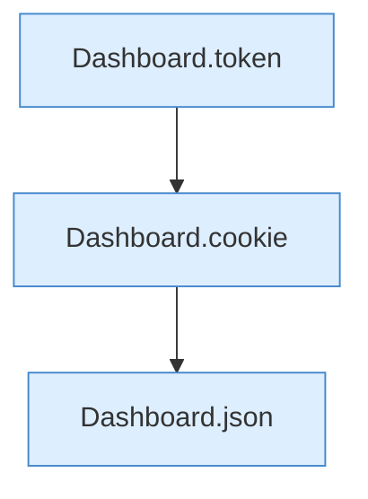

[[00 Start]] › [[Dashboard-HTTP]] › [[HTTP-Routing]] › [[Dashboard.handle]] › [[Dashboard.handle.Z103.Teil7.Z141.Case142]]

# Dashboard.handle.Z103.Teil7.Z141.Case142



```knoten
Dashboard.token
  `token` in `Dashboard.java`.
Dashboard.cookie
  `cookie` in `Dashboard.java`.
Dashboard.json
  Antwortet mit JSON `json`. Ruft `sendBytes`.
```

- Fortsetzung von `Dashboard.handle.Z103.Teil7.Z141`, Quellreihenfolge.
