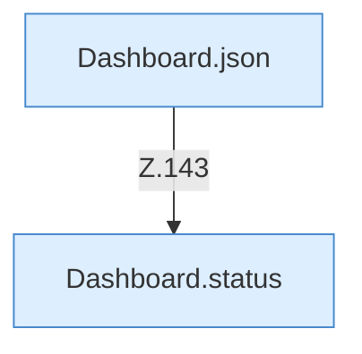

[[00 Start]] › [[Dashboard-HTTP]] › [[HTTP-Routing]] › [[Dashboard.handle]] › [[Dashboard.handle.Z103.Teil7.Z141.Case143]]

# Dashboard.handle.Z103.Teil7.Z141.Case143



```knoten
Dashboard.json
  Die [[Glossar#Web-Schnittstelle|Web-Schnittstelle]] macht hier einen einzelnen Schritt. Eine Ebene tiefer steht er genauer. Antwortet mit JSON `json`. Ruft `sendBytes`.
Dashboard.status
  Liefert den Zustand des [[Glossar#Spielserver|Spielservers]] an die [[Glossar#Bedienseite|Bedienseite]]. Liefert den Status `status`. Ruft `profile`, `slot`, `pid`.
```

> [!knoten]- Was die Blöcke tun
> - **Dashboard.json**: Die [[Glossar#Web-Schnittstelle|Web-Schnittstelle]] macht hier einen einzelnen Schritt. Eine Ebene tiefer steht er genauer. Antwortet mit JSON `json`. Ruft `sendBytes`.
> - **Dashboard.status**: Liefert den Zustand des [[Glossar#Spielserver|Spielservers]] an die [[Glossar#Bedienseite|Bedienseite]]. Liefert den Status `status`. Ruft `profile`, `slot`, `pid`.

- Das Innere eines Wegs, ab [[Glossar#Zeile|Zeile]] 143.
- Fortsetzung von `Dashboard.handle.Z103.Teil7.Z141`.
