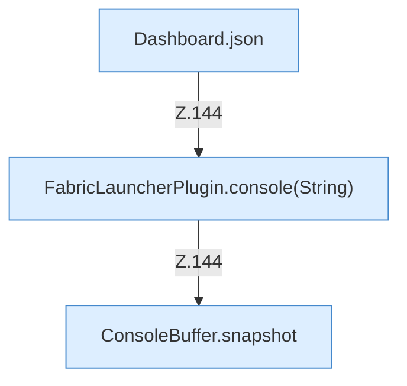

[[00 Start]] › [[Dashboard-HTTP]] › [[HTTP-Routing]] › [[Dashboard.handle]] › [[Dashboard.handle.Z103.Teil7.Z141.Case144]]

# Dashboard.handle.Z103.Teil7.Z141.Case144



```knoten
Dashboard.json
  Die [[Glossar#Web-Schnittstelle|Web-Schnittstelle]] macht hier einen einzelnen Schritt. Eine Ebene tiefer steht er genauer. Antwortet mit JSON `json`. Ruft `sendBytes`.
FabricLauncherPlugin.console(String)
  Liefert die letzten [[Glossar#Zeile|Zeilen]] der [[Glossar#Konsole|Konsole]]. Liefert die Konsole `console`. Ruft `slot`.
ConsoleBuffer.snapshot
  Dieser Teil macht hier einen einzelnen Schritt. Eine Ebene tiefer steht er genauer. `snapshot` in `ConsoleBuffer.java`.
```

> [!knoten]- Was die Blöcke tun
> - **Dashboard.json**: Die [[Glossar#Web-Schnittstelle|Web-Schnittstelle]] macht hier einen einzelnen Schritt. Eine Ebene tiefer steht er genauer. Antwortet mit JSON `json`. Ruft `sendBytes`.
> - **FabricLauncherPlugin.console(String)**: Liefert die letzten [[Glossar#Zeile|Zeilen]] der [[Glossar#Konsole|Konsole]]. Liefert die Konsole `console`. Ruft `slot`.
> - **ConsoleBuffer.snapshot**: Dieser Teil macht hier einen einzelnen Schritt. Eine Ebene tiefer steht er genauer. `snapshot` in `ConsoleBuffer.java`.

- Das Innere eines Wegs, ab [[Glossar#Zeile|Zeile]] 144.
- Fortsetzung von `Dashboard.handle.Z103.Teil7.Z141`.
