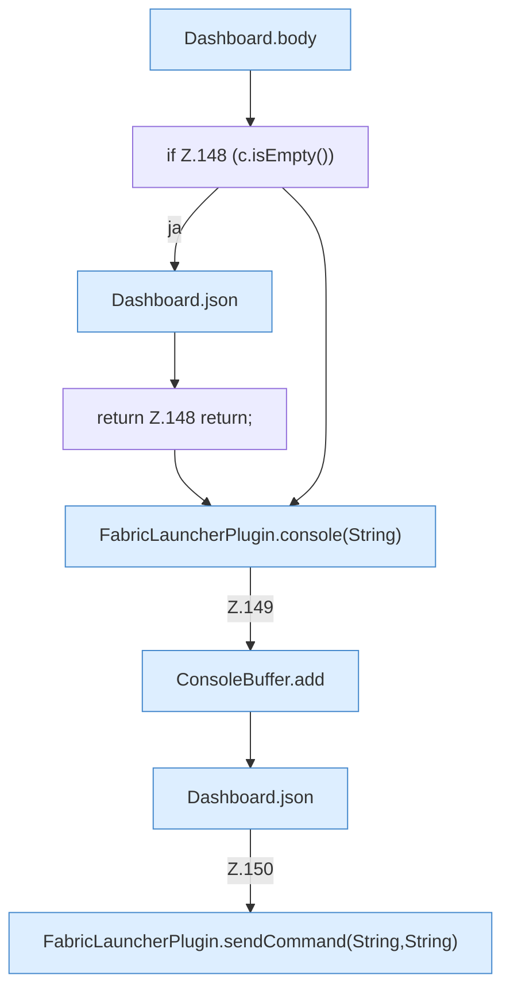

[[00 Start]] › [[Dashboard-HTTP]] › [[HTTP-Routing]] › [[Dashboard.handle]] › [[Dashboard.handle.Z103.Teil7.Z141.Case146]]

# Dashboard.handle.Z103.Teil7.Z141.Case146



```knoten
Dashboard.body
  `body` in `Dashboard.java`. Ruft `readBodyText`.
if Z.148 (c.isEmpty())
  Zeile 148: prüft `(c.isEmpty())`.
Dashboard.json
  Antwortet mit JSON `json`. Ruft `sendBytes`.
return Z.148 return;
  Zeile 148: Rückgabe `return;`.
FabricLauncherPlugin.console(String)
  Liefert die Konsole `console`. Ruft `slot`.
ConsoleBuffer.add
  Fügt hinzu `add`.
FabricLauncherPlugin.sendCommand(String,String)
  Sendet `sendCommand`. Ruft `send`, `slot`.
```

- Fortsetzung von `Dashboard.handle.Z103.Teil7.Z141`, Quellreihenfolge.
