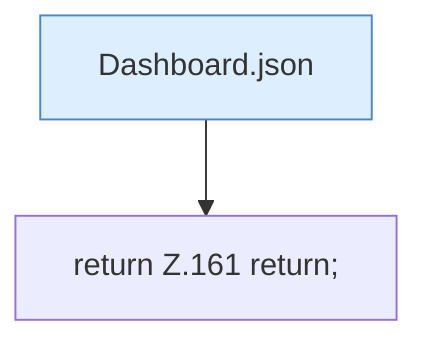

[[00 Start]] › [[Dashboard-HTTP]] › [[HTTP-Routing]] › [[Dashboard.handle]] › [[Dashboard.handle.Z103.Teil7.Z141.Case152.Teil1.Z157.Case161]]

# Dashboard.handle.Z103.Teil7.Z141.Case152.Teil1.Z157.Case161



```knoten
Dashboard.json
  Die [[Glossar#Web-Schnittstelle|Web-Schnittstelle]] macht hier einen einzelnen Schritt. Eine Ebene tiefer steht er genauer. Antwortet mit JSON `json`. Ruft `sendBytes`.
return Z.161 return;
  Zeile 161: Rückgabe `return;`.
```

> [!knoten]- Was die Blöcke tun
> - **Dashboard.json**: Die [[Glossar#Web-Schnittstelle|Web-Schnittstelle]] macht hier einen einzelnen Schritt. Eine Ebene tiefer steht er genauer. Antwortet mit JSON `json`. Ruft `sendBytes`.
> - **return Z.161 return;**: Zeile 161: Rückgabe `return;`.

- Das Innere eines Wegs, ab [[Glossar#Zeile|Zeile]] 161.
- Fortsetzung von `Dashboard.handle.Z103.Teil7.Z141.Case152.Teil1.Z157`.
