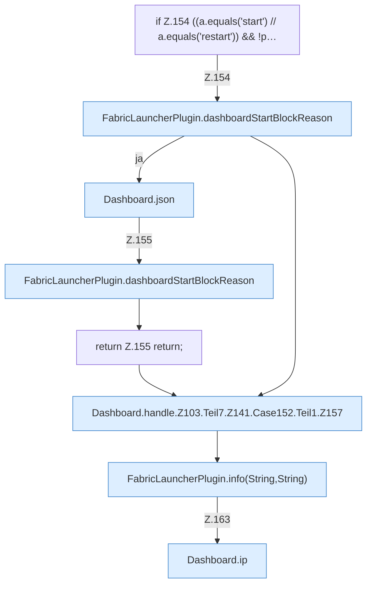

[[00 Start]] › [[Dashboard-HTTP]] › [[HTTP-Routing]] › [[Dashboard.handle]] › [[Dashboard.handle.Z103.Teil7.Z141.Case152.Teil1]]

# Dashboard.handle.Z103.Teil7.Z141.Case152.Teil1



```knoten
if Z.154 ((a.equals('start') // a.equals('restart')) && !p…
  Zeile 154: prüft `((a.equals('start') // a.equals('restart')) && !p…`.
FabricLauncherPlugin.dashboardStartBlockReason
  Das [[Glossar#Plugin|Plugin]] startet hier einen Schritt. Eine Ebene tiefer steht er genauer. `dashboardStartBlockReason` in `FabricLauncherPlugin.java`.
Dashboard.json
  Die [[Glossar#Web-Schnittstelle|Web-Schnittstelle]] macht hier einen einzelnen Schritt. Eine Ebene tiefer steht er genauer. Antwortet mit JSON `json`. Ruft `sendBytes`.
return Z.155 return;
  Zeile 155: Rückgabe `return;`.
Dashboard.handle.Z103.Teil7.Z141.Case152.Teil1.Z157
  Der Ablauf geht in [[Glossar#Zeile|Zeile]] 157 weiter. Eine Ebene tiefer steht er genauer. Fortsetzung des Ablaufs ab Zeile 157.
FabricLauncherPlugin.info(String,String)
  Schreibt eine Hinweiszeile in die [[Glossar#Konsole|Konsole]] des [[Glossar#Spielserver|Spielservers]]. Schreibt eine Infozeile `info`. Ruft `slot`.
Dashboard.ip
  Die [[Glossar#Web-Schnittstelle|Web-Schnittstelle]] macht hier einen einzelnen Schritt. Eine Ebene tiefer steht er genauer. `ip` in `Dashboard.java`.
```

> [!knoten]- Was die Blöcke tun
> - **if Z.154 ((a.equals('start') // a.equals('restart')) && !p…**: Zeile 154: prüft `((a.equals('start') // a.equals('restart')) && !p…`.
> - **FabricLauncherPlugin.dashboardStartBlockReason**: Das [[Glossar#Plugin|Plugin]] startet hier einen Schritt. Eine Ebene tiefer steht er genauer. `dashboardStartBlockReason` in `FabricLauncherPlugin.java`.
> - **Dashboard.json**: Die [[Glossar#Web-Schnittstelle|Web-Schnittstelle]] macht hier einen einzelnen Schritt. Eine Ebene tiefer steht er genauer. Antwortet mit JSON `json`. Ruft `sendBytes`.
> - **return Z.155 return;**: Zeile 155: Rückgabe `return;`.
> - **Dashboard.handle.Z103.Teil7.Z141.Case152.Teil1.Z157**: Der Ablauf geht in [[Glossar#Zeile|Zeile]] 157 weiter. Eine Ebene tiefer steht er genauer. Fortsetzung des Ablaufs ab Zeile 157.
> - **FabricLauncherPlugin.info(String,String)**: Schreibt eine Hinweiszeile in die [[Glossar#Konsole|Konsole]] des [[Glossar#Spielserver|Spielservers]]. Schreibt eine Infozeile `info`. Ruft `slot`.
> - **Dashboard.ip**: Die [[Glossar#Web-Schnittstelle|Web-Schnittstelle]] macht hier einen einzelnen Schritt. Eine Ebene tiefer steht er genauer. `ip` in `Dashboard.java`.

- Ein weiterer Abschnitt derselben Übersicht.
- Fortsetzung von `Dashboard.handle.Z103.Teil7.Z141.Case152`.
