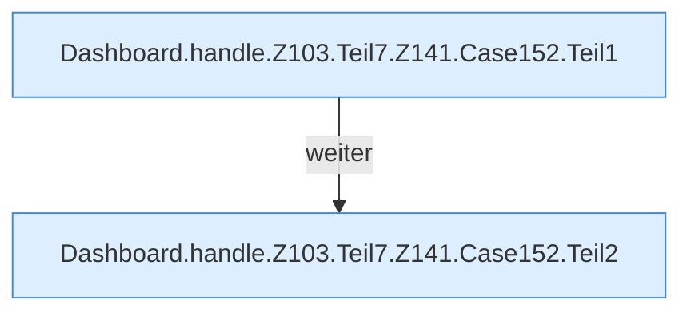

[[00 Start]] › [[Dashboard-HTTP]] › [[HTTP-Routing]] › [[Dashboard.handle]] › [[Dashboard.handle.Z103.Teil7.Z141.Case152]]

# Dashboard.handle.Z103.Teil7.Z141.Case152



```knoten
Dashboard.handle.Z103.Teil7.Z141.Case152.Teil1
  Abschnitt 1 dieses Ablaufs, in Quellreihenfolge.
Dashboard.handle.Z103.Teil7.Z141.Case152.Teil2
  Abschnitt 2 dieses Ablaufs, in Quellreihenfolge.
```

- Fortsetzung von `Dashboard.handle.Z103.Teil7.Z141`, Quellreihenfolge.
