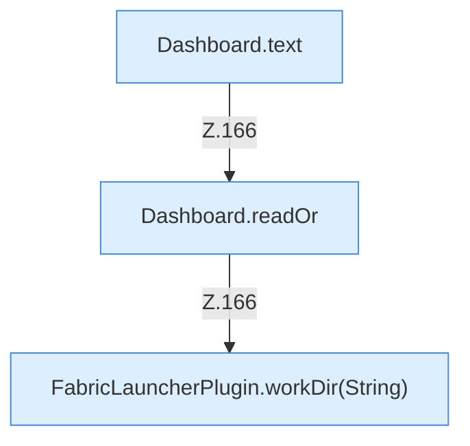

[[00 Start]] › [[Dashboard-HTTP]] › [[HTTP-Routing]] › [[Dashboard.handle]] › [[Dashboard.handle.Z103.Teil7.Z141.Case166]]

# Dashboard.handle.Z103.Teil7.Z141.Case166



```knoten
Dashboard.text
  Antwortet mit Text `text`. Ruft `sendBytes`.
Dashboard.readOr
  Liest `readOr`.
FabricLauncherPlugin.workDir(String)
  `workDir` in `FabricLauncherPlugin.java`. Ruft `profile`, `directory`.
```

- Fortsetzung von `Dashboard.handle.Z103.Teil7.Z141`, Quellreihenfolge.
