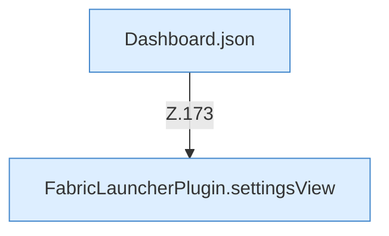

[[00 Start]] › [[Dashboard-HTTP]] › [[HTTP-Routing]] › [[Dashboard.handle]] › [[Dashboard.handle.Z103.Teil7.Z141.Case173]]

# Dashboard.handle.Z103.Teil7.Z141.Case173



```knoten
Dashboard.json
  Antwortet mit JSON `json`. Ruft `sendBytes`.
FabricLauncherPlugin.settingsView
  `settingsView` in `FabricLauncherPlugin.java`. Ruft `from`, `view`.
```

- Fortsetzung von `Dashboard.handle.Z103.Teil7.Z141`, Quellreihenfolge.
