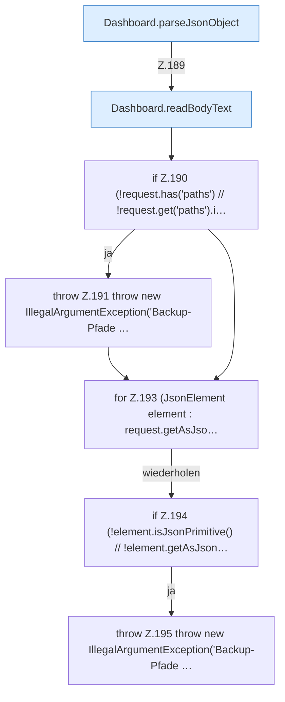

[[00 Start]] › [[Dashboard-HTTP]] › [[HTTP-Routing]] › [[Dashboard.handle]] › [[Dashboard.handle.Z103.Teil7.Z141.Case188.Teil1]]

# Dashboard.handle.Z103.Teil7.Z141.Case188.Teil1

- Fortsetzung von `Dashboard.handle.Z103.Teil7.Z141.Case188`, Quellreihenfolge.
