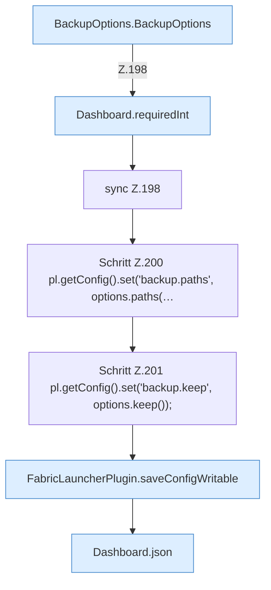

[[00 Start]] › [[Dashboard-HTTP]] › [[HTTP-Routing]] › [[Dashboard.handle]] › [[Dashboard.handle.Z103.Teil7.Z141.Case188.Teil2]]

# Dashboard.handle.Z103.Teil7.Z141.Case188.Teil2



```knoten
BackupOptions.BackupOptions
  Dieser Teil sichert die Optionen. Sichert `BackupOptions`.
Dashboard.requiredInt
  Liest eine Zahl, die in der Anfrage dabei sein muss. Liest verpflichtend `requiredInt`. Ruft `requiredLong`.
sync Z.198
  Zeile 198: synchronisierter Block.
Schritt Z.200 pl.getConfig().set('backup.paths', options.paths(…
  Zeile 200: liest die Config. `pl.getConfig().set('backup.paths', options.paths(…`
Schritt Z.201 pl.getConfig().set('backup.keep', options.keep());
  Zeile 201: liest die Config. `pl.getConfig().set('backup.keep', options.keep());`
FabricLauncherPlugin.saveConfigWritable
  Speichert die [[Glossar#Einstellungsdatei|Einstellungsdatei]] und setzt danach die [[Glossar#Dateirechte|Dateirechte]] so, dass sie beschreibbar bleibt. Speichert `saveConfigWritable`. Ruft `makeWritable`.
Dashboard.json
  Die [[Glossar#Web-Schnittstelle|Web-Schnittstelle]] macht hier einen einzelnen Schritt. Eine Ebene tiefer steht er genauer. Antwortet mit JSON `json`. Ruft `sendBytes`.
```

> [!knoten]- Was die Blöcke tun
> - **BackupOptions.BackupOptions**: Dieser Teil sichert die Optionen. Sichert `BackupOptions`.
> - **Dashboard.requiredInt**: Liest eine Zahl, die in der Anfrage dabei sein muss. Liest verpflichtend `requiredInt`. Ruft `requiredLong`.
> - **sync Z.198**: Zeile 198: synchronisierter Block.
> - **Schritt Z.200 pl.getConfig().set('backup.paths', options.paths(…**: Zeile 200: liest die Config. `pl.getConfig().set('backup.paths', options.paths(…`
> - **Schritt Z.201 pl.getConfig().set('backup.keep', options.keep());**: Zeile 201: liest die Config. `pl.getConfig().set('backup.keep', options.keep());`
> - **FabricLauncherPlugin.saveConfigWritable**: Speichert die [[Glossar#Einstellungsdatei|Einstellungsdatei]] und setzt danach die [[Glossar#Dateirechte|Dateirechte]] so, dass sie beschreibbar bleibt. Speichert `saveConfigWritable`. Ruft `makeWritable`.
> - **Dashboard.json**: Die [[Glossar#Web-Schnittstelle|Web-Schnittstelle]] macht hier einen einzelnen Schritt. Eine Ebene tiefer steht er genauer. Antwortet mit JSON `json`. Ruft `sendBytes`.

- Ein weiterer Abschnitt derselben Übersicht.
- Fortsetzung von `Dashboard.handle.Z103.Teil7.Z141.Case188`.
