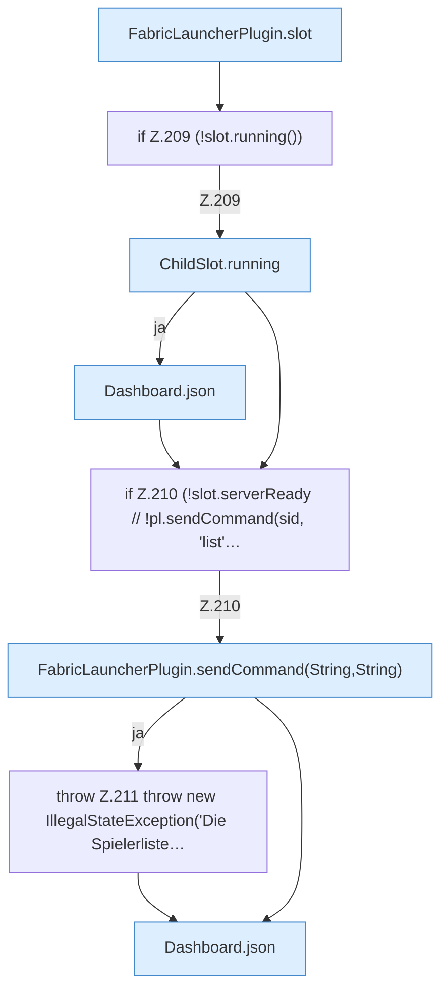

[[00 Start]] › [[Dashboard-HTTP]] › [[HTTP-Routing]] › [[Dashboard.handle]] › [[Dashboard.handle.Z103.Teil7.Z141.Case207]]

# Dashboard.handle.Z103.Teil7.Z141.Case207



```knoten
FabricLauncherPlugin.slot
  Das [[Glossar#Plugin|Plugin]] macht hier einen einzelnen Schritt. Eine Ebene tiefer steht er genauer. `slot` in `FabricLauncherPlugin.java`. Ruft `profile`, `ChildSlot`.
if Z.209 (!slot.running())
  Zeile 209: prüft `(!slot.running())`.
ChildSlot.running
  Dieser Teil prüft, ob läuft, das. Sagt, ob der [[Glossar#Prozess|Prozess]] läuft `running`.
Dashboard.json
  Die [[Glossar#Web-Schnittstelle|Web-Schnittstelle]] macht hier einen einzelnen Schritt. Eine Ebene tiefer steht er genauer. Antwortet mit JSON `json`. Ruft `sendBytes`.
if Z.210 (!slot.serverReady // !pl.sendCommand(sid, 'list'…
  Zeile 210: prüft `(!slot.serverReady // !pl.sendCommand(sid, 'list'…`.
FabricLauncherPlugin.sendCommand(String,String)
  Schickt einen [[Glossar#Befehl|Befehl]] in die [[Glossar#Konsole|Konsole]] des [[Glossar#Spielserver|Spielservers]]. Sendet `sendCommand`. Ruft `send`, `slot`.
throw Z.211 throw new IllegalStateException('Die Spielerliste…
  Zeile 211: Abbruch `throw new IllegalStateException('Die Spielerliste…`.
```

> [!knoten]- Was die Blöcke tun
> - **FabricLauncherPlugin.slot**: Das [[Glossar#Plugin|Plugin]] macht hier einen einzelnen Schritt. Eine Ebene tiefer steht er genauer. `slot` in `FabricLauncherPlugin.java`. Ruft `profile`, `ChildSlot`.
> - **if Z.209 (!slot.running())**: Zeile 209: prüft `(!slot.running())`.
> - **ChildSlot.running**: Dieser Teil prüft, ob läuft, das. Sagt, ob der [[Glossar#Prozess|Prozess]] läuft `running`.
> - **Dashboard.json**: Die [[Glossar#Web-Schnittstelle|Web-Schnittstelle]] macht hier einen einzelnen Schritt. Eine Ebene tiefer steht er genauer. Antwortet mit JSON `json`. Ruft `sendBytes`.
> - **if Z.210 (!slot.serverReady // !pl.sendCommand(sid, 'list'…**: Zeile 210: prüft `(!slot.serverReady // !pl.sendCommand(sid, 'list'…`.
> - **FabricLauncherPlugin.sendCommand(String,String)**: Schickt einen [[Glossar#Befehl|Befehl]] in die [[Glossar#Konsole|Konsole]] des [[Glossar#Spielserver|Spielservers]]. Sendet `sendCommand`. Ruft `send`, `slot`.
> - **throw Z.211 throw new IllegalStateException('Die Spielerliste…**: Zeile 211: Abbruch `throw new IllegalStateException('Die Spielerliste…`.

- Das Innere eines Wegs, ab [[Glossar#Zeile|Zeile]] 207.
- Fortsetzung von `Dashboard.handle.Z103.Teil7.Z141`.
