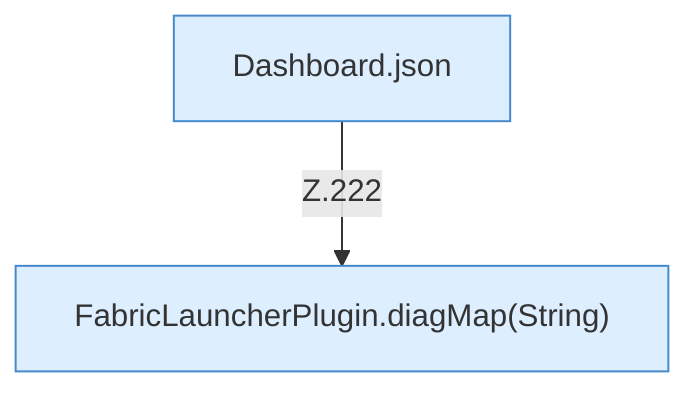

[[00 Start]] › [[Dashboard-HTTP]] › [[HTTP-Routing]] › [[Dashboard.handle]] › [[Dashboard.handle.Z103.Teil7.Z141.Case222]]

# Dashboard.handle.Z103.Teil7.Z141.Case222



```knoten
Dashboard.json
  Die [[Glossar#Web-Schnittstelle|Web-Schnittstelle]] macht hier einen einzelnen Schritt. Eine Ebene tiefer steht er genauer. Antwortet mit JSON `json`. Ruft `sendBytes`.
FabricLauncherPlugin.diagMap(String)
  Sammelt die [[Glossar#Diagnose|Diagnose]] in einer Übersicht. Sammelt die Diagnose `diagMap`. Ruft `slot`, `pid`, `running`.
```

> [!knoten]- Was die Blöcke tun
> - **Dashboard.json**: Die [[Glossar#Web-Schnittstelle|Web-Schnittstelle]] macht hier einen einzelnen Schritt. Eine Ebene tiefer steht er genauer. Antwortet mit JSON `json`. Ruft `sendBytes`.
> - **FabricLauncherPlugin.diagMap(String)**: Sammelt die [[Glossar#Diagnose|Diagnose]] in einer Übersicht. Sammelt die Diagnose `diagMap`. Ruft `slot`, `pid`, `running`.

- Das Innere eines Wegs, ab [[Glossar#Zeile|Zeile]] 222.
- Fortsetzung von `Dashboard.handle.Z103.Teil7.Z141`.
