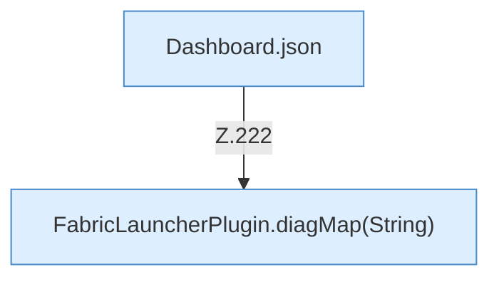

[[00 Start]] › [[Dashboard-HTTP]] › [[HTTP-Routing]] › [[Dashboard.handle]] › [[Dashboard.handle.Z103.Teil7.Z141.Case222]]

# Dashboard.handle.Z103.Teil7.Z141.Case222



```knoten
Dashboard.json
  Antwortet mit JSON `json`. Ruft `sendBytes`.
FabricLauncherPlugin.diagMap(String)
  Sammelt die Diagnose `diagMap`. Ruft `slot`, `pid`, `running`.
```

- Fortsetzung von `Dashboard.handle.Z103.Teil7.Z141`, Quellreihenfolge.
