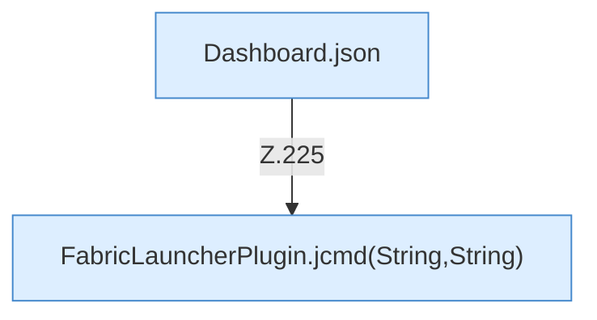

[[00 Start]] › [[Dashboard-HTTP]] › [[HTTP-Routing]] › [[Dashboard.handle]] › [[Dashboard.handle.Z103.Teil7.Z141.Case225]]

# Dashboard.handle.Z103.Teil7.Z141.Case225



```knoten
Dashboard.json
  Antwortet mit JSON `json`. Ruft `sendBytes`.
FabricLauncherPlugin.jcmd(String,String)
  `jcmd` in `FabricLauncherPlugin.java`. Ruft `jcmd`, `slot`, `pid`.
```

- Fortsetzung von `Dashboard.handle.Z103.Teil7.Z141`, Quellreihenfolge.
