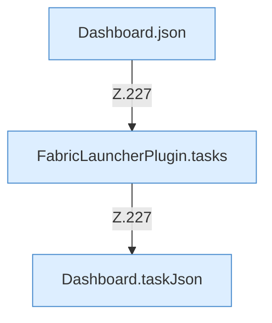

[[00 Start]] › [[Dashboard-HTTP]] › [[HTTP-Routing]] › [[Dashboard.handle]] › [[Dashboard.handle.Z103.Teil7.Z141.Case227]]

# Dashboard.handle.Z103.Teil7.Z141.Case227



```knoten
Dashboard.json
  Die [[Glossar#Web-Schnittstelle|Web-Schnittstelle]] macht hier einen einzelnen Schritt. Eine Ebene tiefer steht er genauer. Antwortet mit JSON `json`. Ruft `sendBytes`.
FabricLauncherPlugin.tasks
  Das [[Glossar#Plugin|Plugin]] macht hier einen einzelnen Schritt. Eine Ebene tiefer steht er genauer. `tasks` in `FabricLauncherPlugin.java`. Ruft `load`.
Dashboard.taskJson
  Liefert eine [[Glossar#Aufgabe|Aufgabe]] als Antwort an die [[Glossar#Bedienseite|Bedienseite]]. `taskJson` in `Dashboard.java`. Ruft `taskNext`, `taskLast`.
```

> [!knoten]- Was die Blöcke tun
> - **Dashboard.json**: Die [[Glossar#Web-Schnittstelle|Web-Schnittstelle]] macht hier einen einzelnen Schritt. Eine Ebene tiefer steht er genauer. Antwortet mit JSON `json`. Ruft `sendBytes`.
> - **FabricLauncherPlugin.tasks**: Das [[Glossar#Plugin|Plugin]] macht hier einen einzelnen Schritt. Eine Ebene tiefer steht er genauer. `tasks` in `FabricLauncherPlugin.java`. Ruft `load`.
> - **Dashboard.taskJson**: Liefert eine [[Glossar#Aufgabe|Aufgabe]] als Antwort an die [[Glossar#Bedienseite|Bedienseite]]. `taskJson` in `Dashboard.java`. Ruft `taskNext`, `taskLast`.

- Das Innere eines Wegs, ab [[Glossar#Zeile|Zeile]] 227.
- Fortsetzung von `Dashboard.handle.Z103.Teil7.Z141`.
