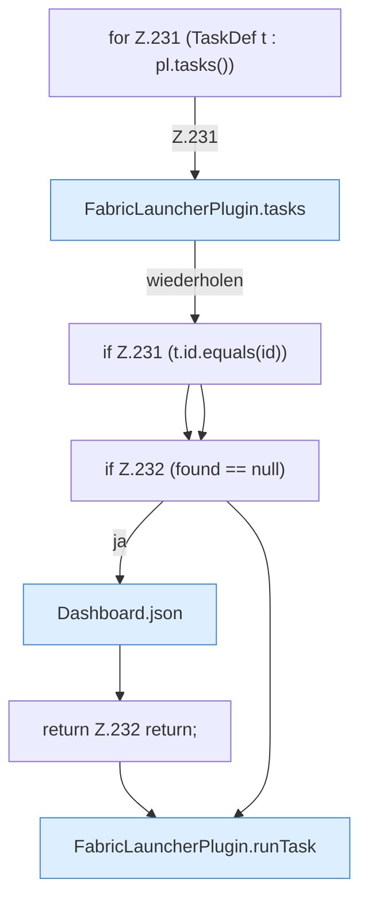

[[00 Start]] › [[Dashboard-HTTP]] › [[HTTP-Routing]] › [[Dashboard.handle]] › [[Dashboard.handle.Z103.Teil7.Z141.Case228.Teil1]]

# Dashboard.handle.Z103.Teil7.Z141.Case228.Teil1



```knoten
for Z.231 (TaskDef t : pl.tasks())
  Zeile 231: Schleife `(TaskDef t : pl.tasks())`.
FabricLauncherPlugin.tasks
  Das [[Glossar#Plugin|Plugin]] macht hier einen einzelnen Schritt. Eine Ebene tiefer steht er genauer. `tasks` in `FabricLauncherPlugin.java`. Ruft `load`.
if Z.231 (t.id.equals(id))
  Zeile 231: prüft `(t.id.equals(id))`.
if Z.232 (found == null)
  Zeile 232: prüft `(found == null)`.
Dashboard.json
  Die [[Glossar#Web-Schnittstelle|Web-Schnittstelle]] macht hier einen einzelnen Schritt. Eine Ebene tiefer steht er genauer. Antwortet mit JSON `json`. Ruft `sendBytes`.
return Z.232 return;
  Zeile 232: Rückgabe `return;`.
FabricLauncherPlugin.runTask
  Das [[Glossar#Plugin|Plugin]] führt aus die [[Glossar#Aufgabe|Aufgabe]]. Führt aus `runTask`. Ruft `executeTask`, `noteTask`, `notifyNtfy`.
```

> [!knoten]- Was die Blöcke tun
> - **for Z.231 (TaskDef t : pl.tasks())**: Zeile 231: Schleife `(TaskDef t : pl.tasks())`.
> - **FabricLauncherPlugin.tasks**: Das [[Glossar#Plugin|Plugin]] macht hier einen einzelnen Schritt. Eine Ebene tiefer steht er genauer. `tasks` in `FabricLauncherPlugin.java`. Ruft `load`.
> - **if Z.231 (t.id.equals(id))**: Zeile 231: prüft `(t.id.equals(id))`.
> - **if Z.232 (found == null)**: Zeile 232: prüft `(found == null)`.
> - **Dashboard.json**: Die [[Glossar#Web-Schnittstelle|Web-Schnittstelle]] macht hier einen einzelnen Schritt. Eine Ebene tiefer steht er genauer. Antwortet mit JSON `json`. Ruft `sendBytes`.
> - **return Z.232 return;**: Zeile 232: Rückgabe `return;`.
> - **FabricLauncherPlugin.runTask**: Das [[Glossar#Plugin|Plugin]] führt aus die [[Glossar#Aufgabe|Aufgabe]]. Führt aus `runTask`. Ruft `executeTask`, `noteTask`, `notifyNtfy`.

- Ein weiterer Abschnitt derselben Übersicht.
- Fortsetzung von `Dashboard.handle.Z103.Teil7.Z141.Case228`.
