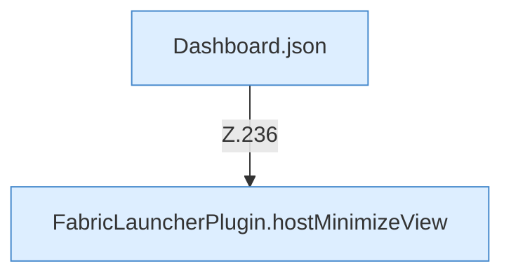

[[00 Start]] › [[Dashboard-HTTP]] › [[HTTP-Routing]] › [[Dashboard.handle]] › [[Dashboard.handle.Z103.Teil7.Z141.Case236]]

# Dashboard.handle.Z103.Teil7.Z141.Case236



```knoten
Dashboard.json
  Die [[Glossar#Web-Schnittstelle|Web-Schnittstelle]] macht hier einen einzelnen Schritt. Eine Ebene tiefer steht er genauer. Antwortet mit JSON `json`. Ruft `sendBytes`.
FabricLauncherPlugin.hostMinimizeView
  Das [[Glossar#Plugin|Plugin]] kümmert sich um das Verkleinern die Ansicht. Betrifft den [[Glossar#Host|Host]] `hostMinimizeView`. Ruft `readHostMinimizeState`, `configuredHostWorld`, `preview`.
```

> [!knoten]- Was die Blöcke tun
> - **Dashboard.json**: Die [[Glossar#Web-Schnittstelle|Web-Schnittstelle]] macht hier einen einzelnen Schritt. Eine Ebene tiefer steht er genauer. Antwortet mit JSON `json`. Ruft `sendBytes`.
> - **FabricLauncherPlugin.hostMinimizeView**: Das [[Glossar#Plugin|Plugin]] kümmert sich um das Verkleinern die Ansicht. Betrifft den [[Glossar#Host|Host]] `hostMinimizeView`. Ruft `readHostMinimizeState`, `configuredHostWorld`, `preview`.

- Das Innere eines Wegs, ab [[Glossar#Zeile|Zeile]] 236.
- Fortsetzung von `Dashboard.handle.Z103.Teil7.Z141`.
