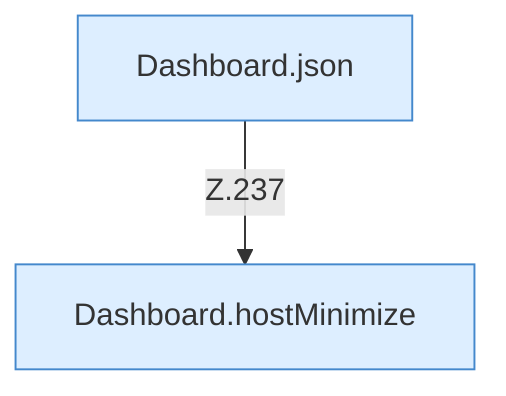

[[00 Start]] › [[Dashboard-HTTP]] › [[HTTP-Routing]] › [[Dashboard.handle]] › [[Dashboard.handle.Z103.Teil7.Z141.Case237]]

# Dashboard.handle.Z103.Teil7.Z141.Case237



```knoten
Dashboard.json
  Antwortet mit JSON `json`. Ruft `sendBytes`.
Dashboard.hostMinimize
  Betrifft den Host `hostMinimize`. Ruft `parseJsonObject`, `readBodyText`, `requiredString`.
```

- Fortsetzung von `Dashboard.handle.Z103.Teil7.Z141`, Quellreihenfolge.
