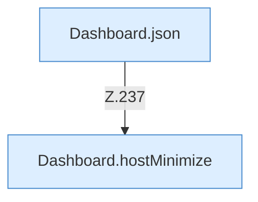

[[00 Start]] › [[Dashboard-HTTP]] › [[HTTP-Routing]] › [[Dashboard.handle]] › [[Dashboard.handle.Z103.Teil7.Z141.Case237]]

# Dashboard.handle.Z103.Teil7.Z141.Case237



```knoten
Dashboard.json
  Die [[Glossar#Web-Schnittstelle|Web-Schnittstelle]] macht hier einen einzelnen Schritt. Eine Ebene tiefer steht er genauer. Antwortet mit JSON `json`. Ruft `sendBytes`.
Dashboard.hostMinimize
  Nimmt von der [[Glossar#Bedienseite|Bedienseite]] den Auftrag an, den [[Glossar#Host|Host]] zu verkleinern oder das zurückzunehmen. Betrifft den Host `hostMinimize`. Ruft `parseJsonObject`, `readBodyText`, `requiredString`.
```

> [!knoten]- Was die Blöcke tun
> - **Dashboard.json**: Die [[Glossar#Web-Schnittstelle|Web-Schnittstelle]] macht hier einen einzelnen Schritt. Eine Ebene tiefer steht er genauer. Antwortet mit JSON `json`. Ruft `sendBytes`.
> - **Dashboard.hostMinimize**: Nimmt von der [[Glossar#Bedienseite|Bedienseite]] den Auftrag an, den [[Glossar#Host|Host]] zu verkleinern oder das zurückzunehmen. Betrifft den Host `hostMinimize`. Ruft `parseJsonObject`, `readBodyText`, `requiredString`.

- Das Innere eines Wegs, ab [[Glossar#Zeile|Zeile]] 237.
- Fortsetzung von `Dashboard.handle.Z103.Teil7.Z141`.
